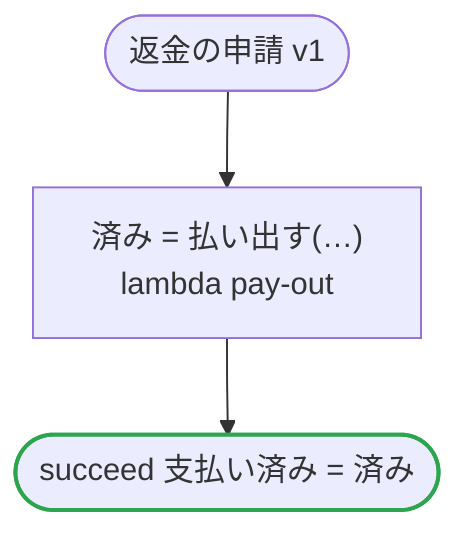

# 返金の申請 v1

注文の残りから返金を払う

`examples/refund_request/refund_request.ja.flow`, drawn by `dandori doc`. Inputs: `申請額: money[USDc] range >=1 <=1000000`, `理由: string`, `残高: 残高`. Outputs: `支払い済み: bool`. `申請額`: Comes from `openapi "specs/refunds.ja.json" schema 返金の申請 property 金額` (`ritsu check` holds the range of its values; the hand-written code that carries the value is not checked). `理由`: Comes from `openapi "specs/refunds.ja.json" schema 返金の申請 property 理由` (`ritsu check` holds the range of its values; the hand-written code that carries the value is not checked). `残高.残り`: Comes from `chobo "books/refunds.ja.book" account 返金できる残り` (`ritsu check` holds the range of its values; the hand-written code that carries the value is not checked).

## flow

A rectangle is a task, one with a line down each side a rule, a slanted one a task whose value comes from outside (an event, or the answer to a callback), a hexagon a `match`, a rounded box a wait, and a box around steps a loop. A dashed arrow is an error the call handles.

## Calls

| Line | Call | Calls | Retries | Timeout | When it fails |
|---:|---|---|---|---|---|
| 23 | `済み = 払い出す(…)` | `lambda pay-out`, `idempotent` | — | — | `timeout`, `failure` → the workflow fails |

## Ends

Every way the workflow can end.

| Line | End |
|---:|---|
| 24 | `succeed 支払い済み = 済み` |

