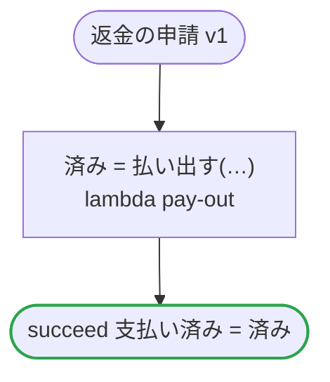

# 返金の申請 v1

注文の残りから返金を払う

`examples/refund_request/refund_request.ja.flow` を `dandori doc` で描いたものです。入力は `申請額: money[USDc] range >=1 <=1000000`・`理由: string`・`残高: 残高`、出力は `支払い済み: bool` です。`申請額`: 出どころ: `openapi "specs/refunds.ja.json" schema 返金の申請 property 金額`（値の範囲は `ritsu check` が確かめます。値を運ぶ手書きのコードは確かめません）。`理由`: 出どころ: `openapi "specs/refunds.ja.json" schema 返金の申請 property 理由`（値の範囲は `ritsu check` が確かめます。値を運ぶ手書きのコードは確かめません）。`残高.残り`: 出どころ: `chobo "books/refunds.ja.book" account 返金できる残り`（値の範囲は `ritsu check` が確かめます。値を運ぶ手書きのコードは確かめません）。

## flow

四角はタスク、両脇に線のある四角は規則、斜めの四角は外から値が届くタスク（イベントやコールバックの応答）、六角形は `match`、角の丸い四角は待ち、ステップを囲む枠はループです。破線の矢印は、呼び出しがその場で処理するエラーです。

## 呼び出し

| 行 | 呼び出し | 呼ぶもの | リトライ | タイムアウト | 失敗したとき |
|---:|---|---|---|---|---|
| 23 | `済み = 払い出す(…)` | `lambda pay-out`・`idempotent` | — | — | `timeout`・`failure` → ワークフローが失敗する |

## 終わり方

ワークフローの終わり方のすべてです。

| 行 | 終わり方 |
|---:|---|
| 24 | `succeed 支払い済み = 済み` |

