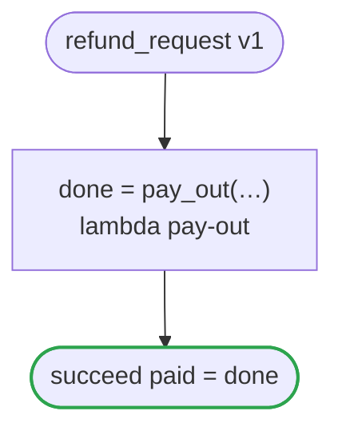

# refund_request v1

Pays a refund out of what is left of the order

`examples/refund_request/refund_request.flow`, drawn by `dandori doc`. Inputs: `amount: money[USDc] range >=1 <=1000000`, `reason: string`, `balance: Balance`. Outputs: `paid: bool`. `amount`: Comes from `openapi "specs/refunds.json" schema RefundCreate property amount` (`ritsu check` holds the range of its values; the hand-written code that carries the value is not checked). `reason`: Comes from `openapi "specs/refunds.json" schema RefundCreate property reason` (`ritsu check` holds the range of its values; the hand-written code that carries the value is not checked). `Balance.left`: Comes from `chobo "books/refunds.book" account remaining` (`ritsu check` holds the range of its values; the hand-written code that carries the value is not checked).

## flow

A rectangle is a task, one with a line down each side a rule, a slanted one a task whose value comes from outside (an event, or the answer to a callback), a hexagon a `match`, a rounded box a wait, and a box around steps a loop. A dashed arrow is an error the call handles.

## Calls

| Line | Call | Calls | Retries | Timeout | When it fails |
|---:|---|---|---|---|---|
| 24 | `done = pay_out(…)` | `lambda pay-out`, `idempotent` | — | — | `timeout`, `failure` → the workflow fails |

## Ends

Every way the workflow can end.

| Line | End |
|---:|---|
| 25 | `succeed paid = done` |

