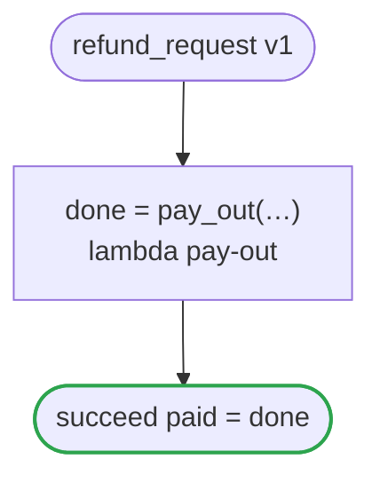

# refund_request v1

Pays a refund out of what is left of the order

`examples/refund_request/refund_request.flow` を `dandori doc` で描いたものです。入力は `amount: money[USDc] range >=1 <=1000000`・`reason: string`・`balance: Balance`、出力は `paid: bool` です。`amount`: 出どころ: `openapi "specs/refunds.json" schema RefundCreate property amount`（値の範囲は `ritsu check` が確かめます。値を運ぶ手書きのコードは確かめません）。`reason`: 出どころ: `openapi "specs/refunds.json" schema RefundCreate property reason`（値の範囲は `ritsu check` が確かめます。値を運ぶ手書きのコードは確かめません）。`Balance.left`: 出どころ: `chobo "books/refunds.book" account remaining`（値の範囲は `ritsu check` が確かめます。値を運ぶ手書きのコードは確かめません）。

## flow

四角はタスク、両脇に線のある四角は規則、斜めの四角は外から値が届くタスク（イベントやコールバックの応答）、六角形は `match`、角の丸い四角は待ち、ステップを囲む枠はループです。破線の矢印は、呼び出しがその場で処理するエラーです。

## 呼び出し

| 行 | 呼び出し | 呼ぶもの | リトライ | タイムアウト | 失敗したとき |
|---:|---|---|---|---|---|
| 24 | `done = pay_out(…)` | `lambda pay-out`・`idempotent` | — | — | `timeout`・`failure` → ワークフローが失敗する |

## 終わり方

ワークフローの終わり方のすべてです。

| 行 | 終わり方 |
|---:|---|
| 25 | `succeed paid = done` |

