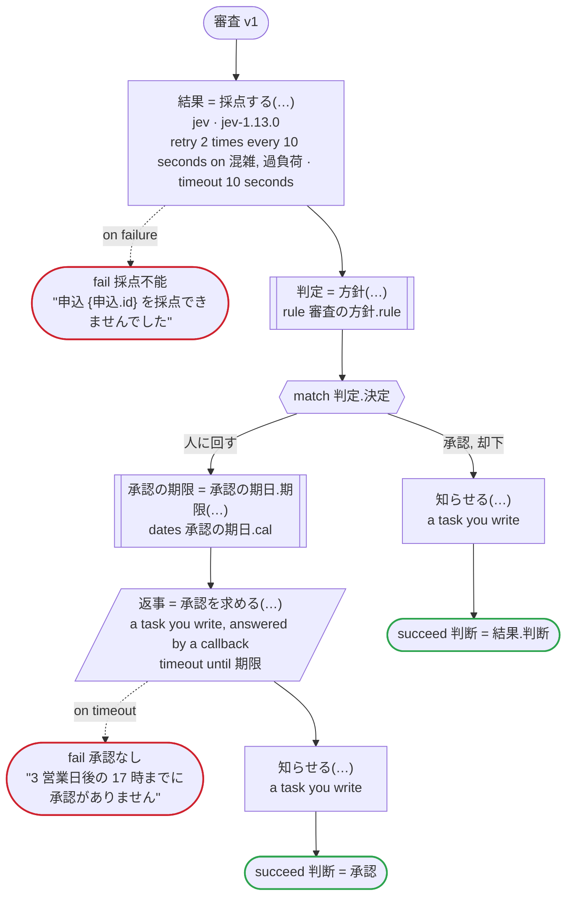

# 審査 v1

Jev が申込を採点してその確信度も返し、その判断をそのまま実行するか、人の承認に回すかを規則が決める。人の承認は、受け付けた日から 3 営業日後の 17 時までに受ける。そのまま承認するには、そのまま却下するより高い確信度が要る。Temporal 向けの版：採点は生成したアクティビティで、専用のタスクキューのワーカーの上で、TypeSafe の API キー（TYPESAFE_API_KEY）で Jev を呼ぶ。そのワーカーは別の言語で書かれていてもよい。お知らせも専用のタスクキューで動く、自分で書くアクティビティ。規則と承認の期日はワークフローのワーカーで動く。承認する人のツールは、生成したクライアントが送る Update でコールバックに応答する

`examples/review/temporal/review.ja.flow`, drawn by `dandori doc`. Inputs: `申込: 申込`. Outputs: `判断: 方針.判断`.

## flow

A rectangle is a task, one with a line down each side a rule or a date of a dates file, a slanted one a task whose value comes from outside (an event, or the answer to a callback), a hexagon a `match`, a rounded box a wait, and a box around steps a loop. A dashed arrow is an error the call handles.

## Calls

| Line | Call | Calls | Retries | Timeout | When it fails |
|---:|---|---|---|---|---|
| 51 | `結果 = 採点する(…)` | `jev · jev-1.13.0` | 2 times every 10 seconds (混雑, 過負荷) | 10 seconds | `混雑`, `過負荷`, `timeout`, `failure` → line 52 |
| 53 | `判定 = 方針(…)` | rule `審査の方針.rule` | 2 times, after 1 second and 2 (failure, timeout) | 10 seconds | `timeout`, `failure` → the workflow fails |
| 57 | `承認の期限 = 承認の期日.期限(…)` | the date `期限` of `承認の期日.cal` | 2 times, after 1 second and 2 (failure, timeout) | 10 seconds | `timeout`, `failure` → the workflow fails |
| 58 | `返事 = 承認を求める(…)` | a task you write, answered by a callback | — | 1 minute to hand the id on, then until `承認の期限.at` | `timeout` → line 59 `failure` → the workflow fails |
| 60 | `知らせる(…)` | a task you write, `idempotent` | — | — | `timeout`, `failure` → the workflow fails |
| 62 | `知らせる(…)` | a task you write, `idempotent` | — | — | `timeout`, `failure` → the workflow fails |

## Ends

Every way the workflow can end.

| Line | End |
|---:|---|
| 52 | `fail 採点不能` "申込 {申込.id} を採点できませんでした" |
| 59 | `fail 承認なし` "3 営業日後の 17 時までに承認がありません" |
| 61 | `succeed 判断 = 承認` |
| 63 | `succeed 判断 = 結果.判断` |

## Rules

The rules this workflow calls, each as the page for people that `rulec doc` renders.

<code>方針</code> · 審査の方針 v1 · <code>../rules/審査の方針.rule</code>

<!-- Generated by rulec 0.40.0 from 審査の方針.rule (sha256:0c12a93ec001). This is a read-only rendering; the source of truth is the .rule file. Edits cannot be carried back. -->
# Rule 審査の方針 v1

申込の採点の判断を、そのまま実行するか人に回すかを、採点の確信度で決める。そのまま承認するには、そのまま却下するより高い確信度が要る。書き下ろしの例

## Inputs

| Name | Type | Range | Notes |
|---|---|---|---|
| 判断 | 判断 (3 values) |  |  |
| 確信度 | rate | 0% to 100% |  |

## Outputs

| Name | Type | Rounding | Notes |
|---|---|---|---|
| 決定 | 決定 (3 values) |  |  |

## Types

An enum is a **closed** finite set. Add a value, and every table that does not look at it fails the completeness check.

- **判断** (3 values) — 却下, 保留, 承認
- **決定** (3 values) — 承認, 却下, 人に回す

## Table 決め方 (policy unique)

| Column | Source |
|---|---|
| 判断 | Input |
| 確信度 | Input |
| → 決定 | Output of this rule |

| # | 判断 | 確信度 | → 決定 (決定) |
|---|---|---|---|
| 1 | 承認 | >=90% | 承認 |
| 2 | 承認 | <90% | 人に回す |
| 3 | 却下 | >=80% | 却下 |
| 4 | 却下 | <80% | 人に回す |
| 5 | 保留 | - | 人に回す |

**What `rulec check` verified**

- Every combination of inputs matches some row (E101 completeness)
- There is no row that can never match (E102 unreachable row)
- No input matches two or more rows at once (E105 overlap). Reordering the rows does not change the meaning

## Examples (verified)

| 判断 | 確信度 | → 決定 |
|---|---|---|
| 承認 | 95% | 承認 |
| 承認 | 89% | 人に回す |
| 却下 | 80% | 却下 |
| 保留 | 99% | 人に回す |

`rulec check` ran these 4 examples through the reference evaluator, and every one produced the declared values (E107). The examples are an **executable specification**.

