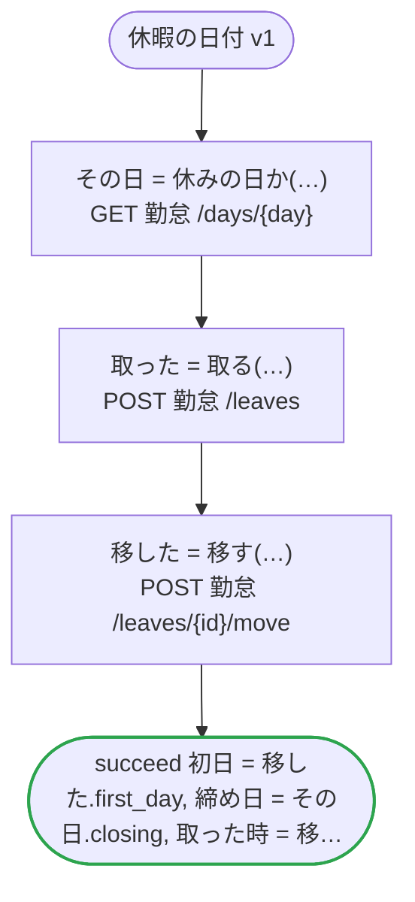

# 休暇の日付 v1

日を日付、時刻を日時と書いた API で休暇を取る。期間は本文に入れ、初日をパスに、最終日をクエリに入れ、応答の日は date で読む

`tests/flows/api_dates.ja.flow`, drawn by `dandori doc`. Inputs: `社員: string`, `休む期間: 期間`. Outputs: `初日: date`, `締め日: date range >=2026-12-01 <=2026-12-31`, `取った時: string`.

## flow

A rectangle is a task, one with a line down each side a rule, a slanted one a task whose value comes from outside (an event, or the answer to a callback), a hexagon a `match`, a rounded box a wait, and a box around steps a loop. A dashed arrow is an error the call handles.

## Calls

| Line | Call | Calls | Retries | Timeout | When it fails |
|---:|---|---|---|---|---|
| 58 | `その日 = 休みの日か(…)` | `GET 勤怠 /days/{day}`, `idempotent` | — | — | `timeout`, `failure` → the workflow fails |
| 59 | `取った = 取る(…)` | `POST 勤怠 /leaves` | — | — | `timeout`, `failure` → the workflow fails |
| 60 | `移した = 移す(…)` | `POST 勤怠 /leaves/{id}/move` | — | — | `timeout`, `failure` → the workflow fails |

## Ends

Every way the workflow can end.

| Line | End |
|---:|---|
| 61 | `succeed 初日 = 移した.first_day, 締め日 = その日.closing, 取った時 = 移した.booked_at` |

