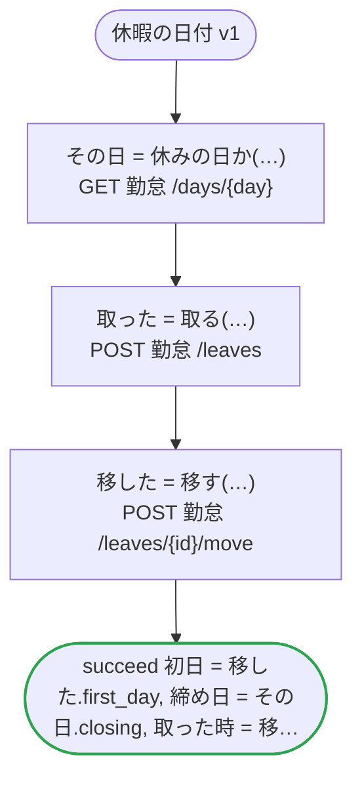

# 休暇の日付 v1

日を日付、時刻を日時と書いた API で休暇を取る。期間は本文に入れ、初日をパスに、最終日をクエリに入れ、応答の日は date で読む

`tests/flows/api_dates.ja.flow` を `dandori doc` で描いたものです。入力は `社員: string`・`休む期間: 期間`、出力は `初日: date`・`締め日: date range >=2026-12-01 <=2026-12-31`・`取った時: string` です。

## flow

四角はタスク、両脇に線のある四角は規則、斜めの四角は外から値が届くタスク（イベントやコールバックの応答）、六角形は `match`、角の丸い四角は待ち、ステップを囲む枠はループです。破線の矢印は、呼び出しがその場で処理するエラーです。

## 呼び出し

| 行 | 呼び出し | 呼ぶもの | リトライ | タイムアウト | 失敗したとき |
|---:|---|---|---|---|---|
| 58 | `その日 = 休みの日か(…)` | `GET 勤怠 /days/{day}`・`idempotent` | — | — | `timeout`・`failure` → ワークフローが失敗する |
| 59 | `取った = 取る(…)` | `POST 勤怠 /leaves` | — | — | `timeout`・`failure` → ワークフローが失敗する |
| 60 | `移した = 移す(…)` | `POST 勤怠 /leaves/{id}/move` | — | — | `timeout`・`failure` → ワークフローが失敗する |

## 終わり方

ワークフローの終わり方のすべてです。

| 行 | 終わり方 |
|---:|---|
| 61 | `succeed 初日 = 移した.first_day, 締め日 = その日.closing, 取った時 = 移した.booked_at` |

