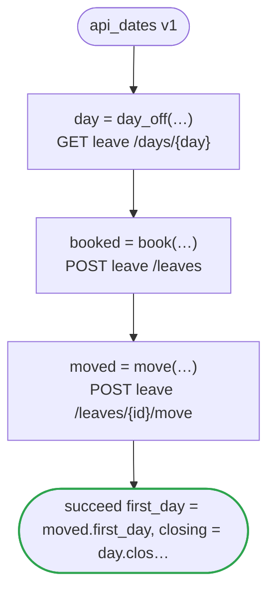

# api_dates v1

Book a leave with an API whose days are dates and whose moments are dates and times: the period goes in the body, its first day in the path and its last in the query, and the days of the answers are read as dates

`tests/flows/api_dates.flow`, drawn by `dandori doc`. Inputs: `employee: string`, `period: Period`. Outputs: `first_day: date`, `closing: date range >=2026-12-01 <=2026-12-31`, `booked_at: string`.

## flow

A rectangle is a task, one with a line down each side a rule, a slanted one a task whose value comes from outside (an event, or the answer to a callback), a hexagon a `match`, a rounded box a wait, and a box around steps a loop. A dashed arrow is an error the call handles.

## Calls

| Line | Call | Calls | Retries | Timeout | When it fails |
|---:|---|---|---|---|---|
| 59 | `day = day_off(…)` | `GET leave /days/{day}`, `idempotent` | — | — | `timeout`, `failure` → the workflow fails |
| 60 | `booked = book(…)` | `POST leave /leaves` | — | — | `timeout`, `failure` → the workflow fails |
| 61 | `moved = move(…)` | `POST leave /leaves/{id}/move` | — | — | `timeout`, `failure` → the workflow fails |

## Ends

Every way the workflow can end.

| Line | End |
|---:|---|
| 62 | `succeed first_day = moved.first_day, closing = day.closing, booked_at = moved.booked_at` |

