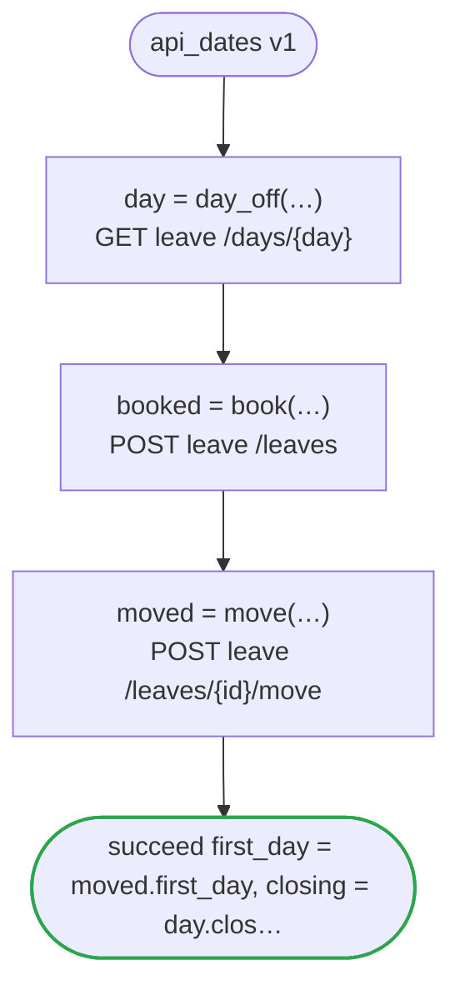

# api_dates v1

Book a leave with an API whose days are dates and whose moments are dates and times: the period goes in the body, its first day in the path and its last in the query, and the days of the answers are read as dates

`tests/flows/api_dates.flow` を `dandori doc` で描いたものです。入力は `employee: string`・`period: Period`、出力は `first_day: date`・`closing: date range >=2026-12-01 <=2026-12-31`・`booked_at: string` です。

## flow

四角はタスク、両脇に線のある四角は規則、斜めの四角は外から値が届くタスク（イベントやコールバックの応答）、六角形は `match`、角の丸い四角は待ち、ステップを囲む枠はループです。破線の矢印は、呼び出しがその場で処理するエラーです。

## 呼び出し

| 行 | 呼び出し | 呼ぶもの | リトライ | タイムアウト | 失敗したとき |
|---:|---|---|---|---|---|
| 59 | `day = day_off(…)` | `GET leave /days/{day}`・`idempotent` | — | — | `timeout`・`failure` → ワークフローが失敗する |
| 60 | `booked = book(…)` | `POST leave /leaves` | — | — | `timeout`・`failure` → ワークフローが失敗する |
| 61 | `moved = move(…)` | `POST leave /leaves/{id}/move` | — | — | `timeout`・`failure` → ワークフローが失敗する |

## 終わり方

ワークフローの終わり方のすべてです。

| 行 | 終わり方 |
|---:|---|
| 62 | `succeed first_day = moved.first_day, closing = day.closing, booked_at = moved.booked_at` |

