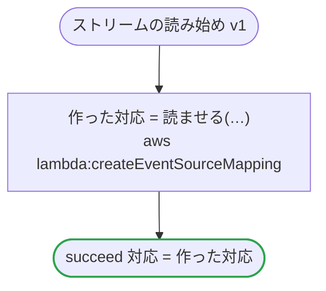

# ストリームの読み始め v1

ある時刻から先のストリームのレコードを関数に読ませる。時刻を受け取り、別の時刻を答える AWS の API を使う

`tests/flows/aws_times.ja.flow`, drawn by `dandori doc`. Inputs: `いつから: timestamp`. Outputs: `対応: 対応`.

## flow

A rectangle is a task, one with a line down each side a rule, a slanted one a task whose value comes from outside (an event, or the answer to a callback), a hexagon a `match`, a rounded box a wait, and a box around steps a loop. A dashed arrow is an error the call handles.

## Calls

| Line | Call | Calls | Retries | Timeout | When it fails |
|---:|---|---|---|---|---|
| 30 | `作った対応 = 読ませる(…)` | `aws lambda:createEventSourceMapping` | — | — | `timeout`, `failure` → the workflow fails |

## Ends

Every way the workflow can end.

| Line | End |
|---:|---|
| 31 | `succeed 対応 = 作った対応` |

