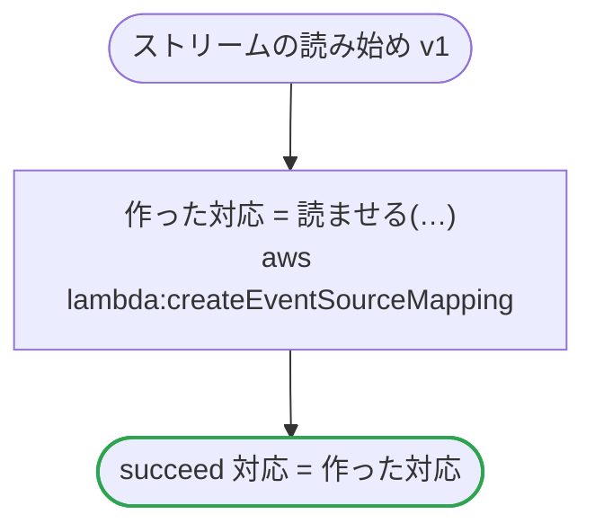

# ストリームの読み始め v1

ある時刻から先のストリームのレコードを関数に読ませる。時刻を受け取り、別の時刻を答える AWS の API を使う

`tests/flows/aws_times.ja.flow` を `dandori doc` で描いたものです。入力は `いつから: timestamp`、出力は `対応: 対応` です。

## flow

四角はタスク、両脇に線のある四角は規則、斜めの四角は外から値が届くタスク（イベントやコールバックの応答）、六角形は `match`、角の丸い四角は待ち、ステップを囲む枠はループです。破線の矢印は、呼び出しがその場で処理するエラーです。

## 呼び出し

| 行 | 呼び出し | 呼ぶもの | リトライ | タイムアウト | 失敗したとき |
|---:|---|---|---|---|---|
| 30 | `作った対応 = 読ませる(…)` | `aws lambda:createEventSourceMapping` | — | — | `timeout`・`failure` → ワークフローが失敗する |

## 終わり方

ワークフローの終わり方のすべてです。

| 行 | 終わり方 |
|---:|---|
| 31 | `succeed 対応 = 作った対応` |

