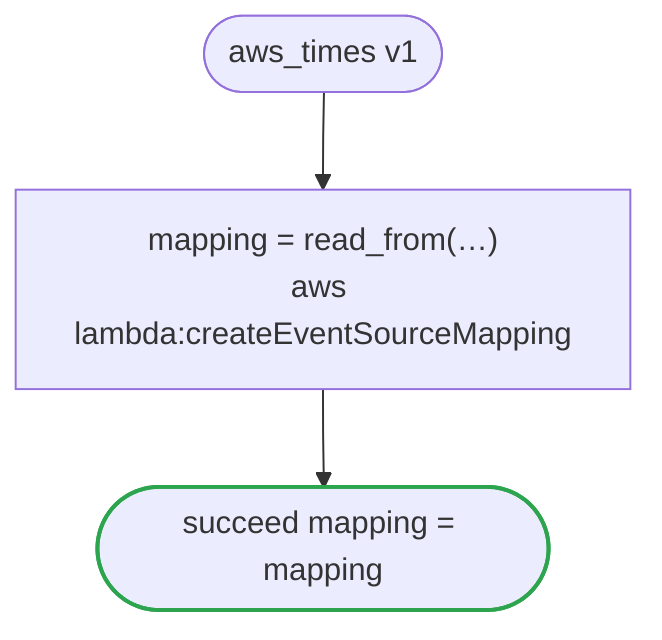

# aws_times v1

Have a function read a stream's records from a moment on, through an AWS API that takes the moment and answers another

`tests/flows/aws_times.flow`, drawn by `dandori doc`. Inputs: `from: timestamp`. Outputs: `mapping: Mapping`.

## flow

A rectangle is a task, one with a line down each side a rule, a slanted one a task whose value comes from outside (an event, or the answer to a callback), a hexagon a `match`, a rounded box a wait, and a box around steps a loop. A dashed arrow is an error the call handles.

## Calls

| Line | Call | Calls | Retries | Timeout | When it fails |
|---:|---|---|---|---|---|
| 29 | `mapping = read_from(…)` | `aws lambda:createEventSourceMapping` | — | — | `timeout`, `failure` → the workflow fails |

## Ends

Every way the workflow can end.

| Line | End |
|---:|---|
| 30 | `succeed mapping = mapping` |

