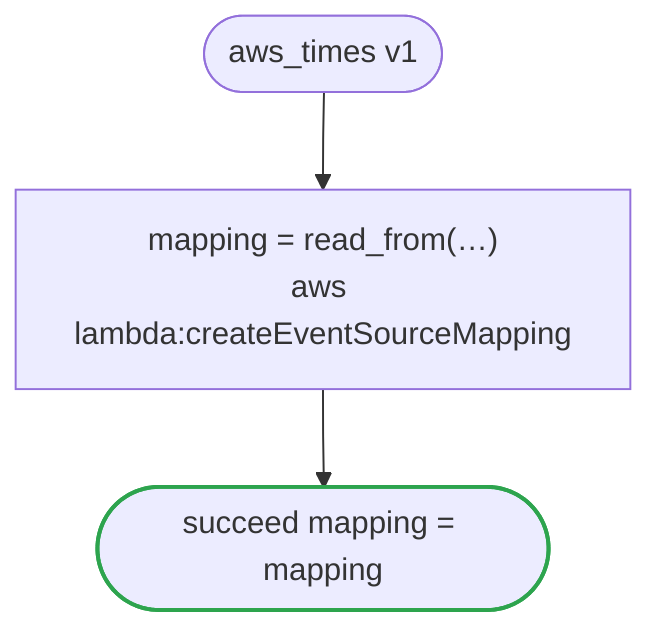

# aws_times v1

Have a function read a stream's records from a moment on, through an AWS API that takes the moment and answers another

`tests/flows/aws_times.flow` を `dandori doc` で描いたものです。入力は `from: timestamp`、出力は `mapping: Mapping` です。

## flow

四角はタスク、両脇に線のある四角は規則、斜めの四角は外から値が届くタスク（イベントやコールバックの応答）、六角形は `match`、角の丸い四角は待ち、ステップを囲む枠はループです。破線の矢印は、呼び出しがその場で処理するエラーです。

## 呼び出し

| 行 | 呼び出し | 呼ぶもの | リトライ | タイムアウト | 失敗したとき |
|---:|---|---|---|---|---|
| 29 | `mapping = read_from(…)` | `aws lambda:createEventSourceMapping` | — | — | `timeout`・`failure` → ワークフローが失敗する |

## 終わり方

ワークフローの終わり方のすべてです。

| 行 | 終わり方 |
|---:|---|
| 30 | `succeed mapping = mapping` |

