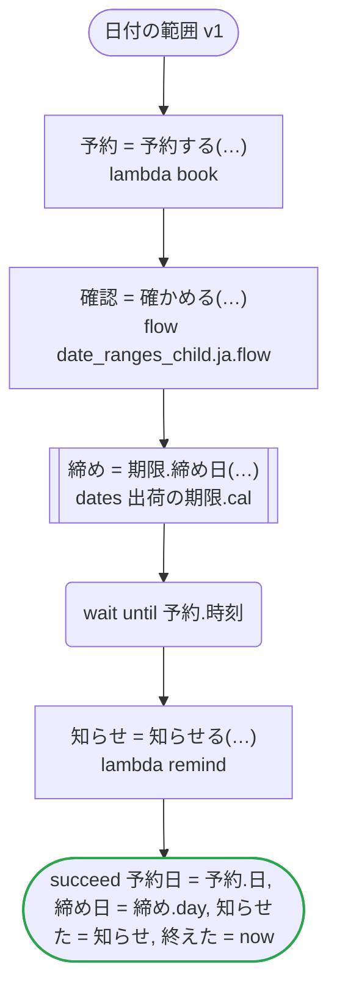
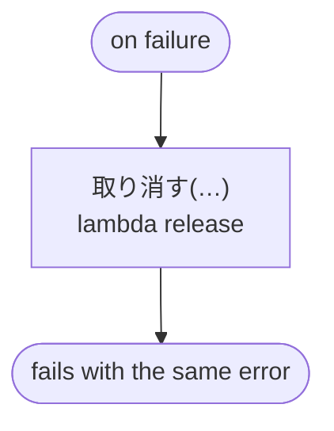

# 日付の範囲 v1

来訪を範囲の日に予約し、子のワークフローで確かめ、予約の時刻まで待ってから知らせる。ワークフローは期間の中で動き、走り始めと、読む now のそれぞれを期間で確かめる

`tests/flows/date_ranges.ja.flow`, drawn by `dandori doc`. Inputs: `訪問: 来訪`, `以降: date range >=2026-01-01`, `締め切り: timestamp range <=2027-12-31`. Outputs: `予約日: date range >=2026-01-01 <=2027-12-31`, `締め日: date`, `知らせた: timestamp range >=2026-01-01 <=2027-12-31`, `終えた: timestamp range >=2026-01-01 <=2027-12-31`. It runs in the period `now range >=2026-04-01 <=2026-06-30 offset +09:00`.

## flow

A rectangle is a task, one with a line down each side a rule or a date of a dates file, a slanted one a task whose value comes from outside (an event, or the answer to a callback), a hexagon a `match`, a rounded box a wait, and a box around steps a loop. A dashed arrow is an error the call handles.

## on failure

Runs when a call fails and nothing at the call handles the error: from the calls on lines 56, 57, 59 and 62. It runs too when `now` on lines 59, 62 and 63 is outside the period the workflow runs in, `>=2026-04-01 <=2026-06-30 offset +09:00`. When it runs to its end, the workflow fails with that error.

## Calls

| Line | Call | Calls | Retries | Timeout | When it fails |
|---:|---|---|---|---|---|
| 56 | `予約 = 予約する(…)` | `lambda book`, `idempotent` | — | — | `timeout`, `failure` → `on failure` |
| 57 | `確認 = 確かめる(…)` | `flow date_ranges_child.ja.flow` | — | — | `timeout`, `failure` → `on failure` |
| 59 | `締め = 期限.締め日(…)` | the date `締め日` of `出荷の期限.cal` | 2 times, after 1 second and 2 (failure, timeout) | 10 seconds | `timeout`, `failure` → `on failure` |
| 62 | `知らせ = 知らせる(…)` | `lambda remind`, `idempotent` | — | — | `timeout`, `failure` → `on failure` |
| 67 | `取り消す(…)` | `lambda release`, `idempotent` | — | — | `timeout`, `failure` → the workflow fails |

## Ends

Every way the workflow can end.

| Line | End |
|---:|---|
| 63 | `succeed 予約日 = 予約.日, 締め日 = 締め.day, 知らせた = 知らせ, 終えた = now` |
| 67 | `on failure` runs to its end, and the workflow fails with the error that started it |

