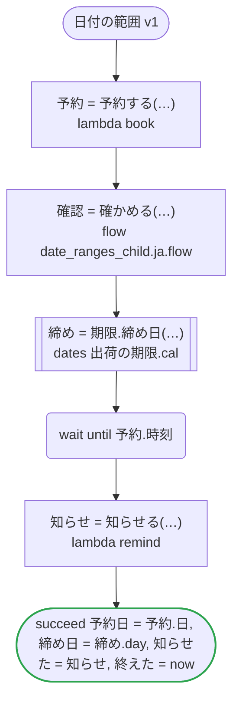
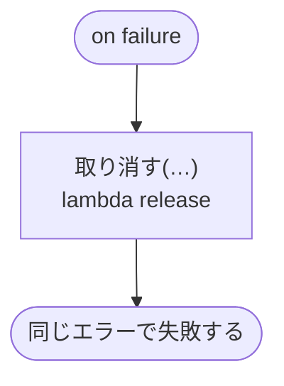

# 日付の範囲 v1

来訪を範囲の日に予約し、子のワークフローで確かめ、予約の時刻まで待ってから知らせる。ワークフローは期間の中で動き、走り始めと、読む now のそれぞれを期間で確かめる

`tests/flows/date_ranges.ja.flow` を `dandori doc` で描いたものです。入力は `訪問: 来訪`・`以降: date range >=2026-01-01`・`締め切り: timestamp range <=2027-12-31`、出力は `予約日: date range >=2026-01-01 <=2027-12-31`・`締め日: date`・`知らせた: timestamp range >=2026-01-01 <=2027-12-31`・`終えた: timestamp range >=2026-01-01 <=2027-12-31` です。動く期間は `now range >=2026-04-01 <=2026-06-30 offset +09:00` です。

## flow

四角はタスク、両脇に線のある四角は規則か日付のファイルの日付、斜めの四角は外から値が届くタスク（イベントやコールバックの応答）、六角形は `match`、角の丸い四角は待ち、ステップを囲む枠はループです。破線の矢印は、呼び出しがその場で処理するエラーです。

## on failure

呼び出しが失敗し、そのエラーをその場で処理しないときに走ります（56・57・59・62 行目の呼び出しから）。59・62・63 行目の `now` がワークフローの動く期間 `>=2026-04-01 <=2026-06-30 offset +09:00` の外のときにも走ります。最後まで走ると、ワークフローはそのエラーで失敗します。

## 呼び出し

| 行 | 呼び出し | 呼ぶもの | リトライ | タイムアウト | 失敗したとき |
|---:|---|---|---|---|---|
| 56 | `予約 = 予約する(…)` | `lambda book`・`idempotent` | — | — | `timeout`・`failure` → `on failure` |
| 57 | `確認 = 確かめる(…)` | `flow date_ranges_child.ja.flow` | — | — | `timeout`・`failure` → `on failure` |
| 59 | `締め = 期限.締め日(…)` | `出荷の期限.cal` の日付 `締め日` | 1 秒後と 2 秒後の 2 回（failure・timeout） | 10 秒 | `timeout`・`failure` → `on failure` |
| 62 | `知らせ = 知らせる(…)` | `lambda remind`・`idempotent` | — | — | `timeout`・`failure` → `on failure` |
| 67 | `取り消す(…)` | `lambda release`・`idempotent` | — | — | `timeout`・`failure` → ワークフローが失敗する |

## 終わり方

ワークフローの終わり方のすべてです。

| 行 | 終わり方 |
|---:|---|
| 63 | `succeed 予約日 = 予約.日, 締め日 = 締め.day, 知らせた = 知らせ, 終えた = now` |
| 67 | `on failure` が最後まで走り、ワークフローは元のエラーで失敗する |

