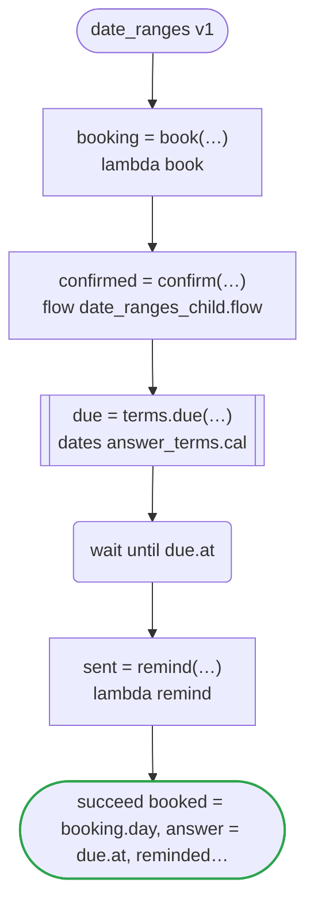
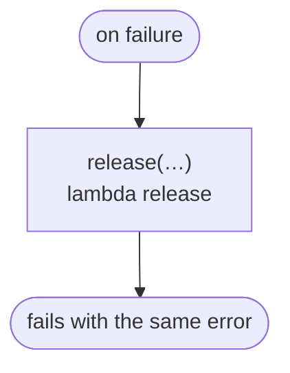

# date_ranges v1

A visit is booked on a day of its range, confirmed by a child workflow, and reminded of after the wait for its answer; the workflow runs in a period, which the start of a run and each now it reads are held to

`tests/flows/date_ranges.flow`, drawn by `dandori doc`. Inputs: `visit: Visit`, `after: date range >=2026-01-01`, `until: timestamp range <=2027-12-31`. Outputs: `booked: date range >=2026-01-01 <=2027-12-31`, `answer: timestamp`, `reminded: timestamp range >=2026-01-01 <=2027-12-31`, `done: timestamp range >=2026-01-01 <=2027-12-31`. It runs in the period `now range >=2026-04-01 <=2027-12-31`.

## flow

A rectangle is a task, one with a line down each side a rule or a date of a dates file, a slanted one a task whose value comes from outside (an event, or the answer to a callback), a hexagon a `match`, a rounded box a wait, and a box around steps a loop. A dashed arrow is an error the call handles.

## on failure

Runs when a call fails and nothing at the call handles the error: from the calls on lines 57, 58, 60 and 63. It runs too when `now` on lines 60, 63 and 64 is outside the period the workflow runs in, `>=2026-04-01 <=2027-12-31`. When it runs to its end, the workflow fails with that error.

## Calls

| Line | Call | Calls | Retries | Timeout | When it fails |
|---:|---|---|---|---|---|
| 57 | `booking = book(…)` | `lambda book`, `idempotent` | — | — | `timeout`, `failure` → `on failure` |
| 58 | `confirmed = confirm(…)` | `flow date_ranges_child.flow` | — | — | `timeout`, `failure` → `on failure` |
| 60 | `due = terms.due(…)` | the date `due` of `answer_terms.cal` | 2 times, after 1 second and 2 (failure, timeout) | 10 seconds | `timeout`, `failure` → `on failure` |
| 63 | `sent = remind(…)` | `lambda remind`, `idempotent` | — | — | `timeout`, `failure` → `on failure` |
| 68 | `release(…)` | `lambda release`, `idempotent` | — | — | `timeout`, `failure` → the workflow fails |

## Ends

Every way the workflow can end.

| Line | End |
|---:|---|
| 64 | `succeed booked = booking.day, answer = due.at, reminded = sent, done = now` |
| 68 | `on failure` runs to its end, and the workflow fails with the error that started it |

