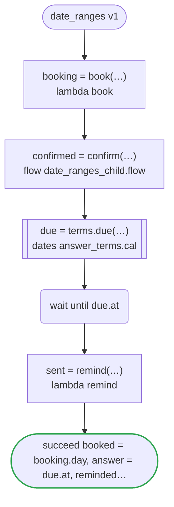
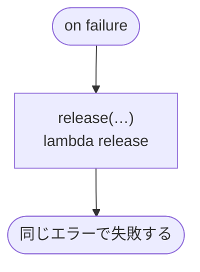

# date_ranges v1

A visit is booked on a day of its range, confirmed by a child workflow, and reminded of after the wait for its answer; the workflow runs in a period, which the start of a run and each now it reads are held to

`tests/flows/date_ranges.flow` を `dandori doc` で描いたものです。入力は `visit: Visit`・`after: date range >=2026-01-01`・`until: timestamp range <=2027-12-31`、出力は `booked: date range >=2026-01-01 <=2027-12-31`・`answer: timestamp`・`reminded: timestamp range >=2026-01-01 <=2027-12-31`・`done: timestamp range >=2026-01-01 <=2027-12-31` です。動く期間は `now range >=2026-04-01 <=2027-12-31` です。

## flow

四角はタスク、両脇に線のある四角は規則か日付のファイルの日付、斜めの四角は外から値が届くタスク（イベントやコールバックの応答）、六角形は `match`、角の丸い四角は待ち、ステップを囲む枠はループです。破線の矢印は、呼び出しがその場で処理するエラーです。

## on failure

呼び出しが失敗し、そのエラーをその場で処理しないときに走ります（57・58・60・63 行目の呼び出しから）。60・63・64 行目の `now` がワークフローの動く期間 `>=2026-04-01 <=2027-12-31` の外のときにも走ります。最後まで走ると、ワークフローはそのエラーで失敗します。

## 呼び出し

| 行 | 呼び出し | 呼ぶもの | リトライ | タイムアウト | 失敗したとき |
|---:|---|---|---|---|---|
| 57 | `booking = book(…)` | `lambda book`・`idempotent` | — | — | `timeout`・`failure` → `on failure` |
| 58 | `confirmed = confirm(…)` | `flow date_ranges_child.flow` | — | — | `timeout`・`failure` → `on failure` |
| 60 | `due = terms.due(…)` | `answer_terms.cal` の日付 `due` | 1 秒後と 2 秒後の 2 回（failure・timeout） | 10 秒 | `timeout`・`failure` → `on failure` |
| 63 | `sent = remind(…)` | `lambda remind`・`idempotent` | — | — | `timeout`・`failure` → `on failure` |
| 68 | `release(…)` | `lambda release`・`idempotent` | — | — | `timeout`・`failure` → ワークフローが失敗する |

## 終わり方

ワークフローの終わり方のすべてです。

| 行 | 終わり方 |
|---:|---|
| 64 | `succeed booked = booking.day, answer = due.at, reminded = sent, done = now` |
| 68 | `on failure` が最後まで走り、ワークフローは元のエラーで失敗する |

