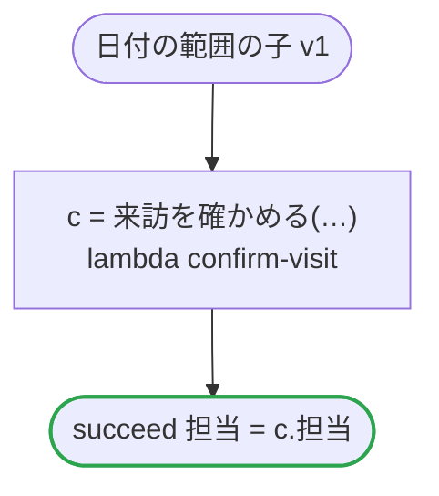

# 日付の範囲の子 v1

来訪を、それぞれの範囲に収めた日と時間帯で確かめる。date_ranges.ja.flow がこれを子として走らせ、検査は、そこから渡すものをその範囲で確かめる。どのプラットフォームでも動く

`tests/flows/date_ranges_child.ja.flow`, drawn by `dandori doc`. Inputs: `id: string`, `日: date range >=2026-01-01 <=2027-12-31`, `時間帯: timestamp range >=2026-01-01 <=2027-12-31 offset +09:00`. Outputs: `担当: string`.

## flow

A rectangle is a task, one with a line down each side a rule, a slanted one a task whose value comes from outside (an event, or the answer to a callback), a hexagon a `match`, a rounded box a wait, and a box around steps a loop. A dashed arrow is an error the call handles.

## Calls

| Line | Call | Calls | Retries | Timeout | When it fails |
|---:|---|---|---|---|---|
| 20 | `c = 来訪を確かめる(…)` | `lambda confirm-visit`, `idempotent` | — | — | `timeout`, `failure` → the workflow fails |

## Ends

Every way the workflow can end.

| Line | End |
|---:|---|
| 21 | `succeed 担当 = c.担当` |

