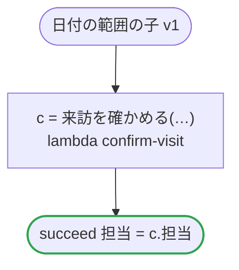

# 日付の範囲の子 v1

来訪を、それぞれの範囲に収めた日と時間帯で確かめる。date_ranges.ja.flow がこれを子として走らせ、検査は、そこから渡すものをその範囲で確かめる。どのプラットフォームでも動く

`tests/flows/date_ranges_child.ja.flow` を `dandori doc` で描いたものです。入力は `id: string`・`日: date range >=2026-01-01 <=2027-12-31`・`時間帯: timestamp range >=2026-01-01 <=2027-12-31 offset +09:00`、出力は `担当: string` です。

## flow

四角はタスク、両脇に線のある四角は規則、斜めの四角は外から値が届くタスク（イベントやコールバックの応答）、六角形は `match`、角の丸い四角は待ち、ステップを囲む枠はループです。破線の矢印は、呼び出しがその場で処理するエラーです。

## 呼び出し

| 行 | 呼び出し | 呼ぶもの | リトライ | タイムアウト | 失敗したとき |
|---:|---|---|---|---|---|
| 20 | `c = 来訪を確かめる(…)` | `lambda confirm-visit`・`idempotent` | — | — | `timeout`・`failure` → ワークフローが失敗する |

## 終わり方

ワークフローの終わり方のすべてです。

| 行 | 終わり方 |
|---:|---|
| 21 | `succeed 担当 = c.担当` |

