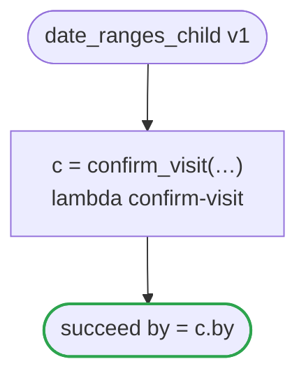

# date_ranges_child v1

Confirms a visit on a day and in a window it holds to ranges of its own: date_ranges.flow runs it as its child, and the checker holds what that passes to them. It runs on every platform

`tests/flows/date_ranges_child.flow`, drawn by `dandori doc`. Inputs: `id: string`, `day: date range >=2026-01-01 <=2027-12-31`, `window: timestamp range >=2026-01-01 <=2027-12-31 offset +09:00`. Outputs: `by: string`.

## flow

A rectangle is a task, one with a line down each side a rule, a slanted one a task whose value comes from outside (an event, or the answer to a callback), a hexagon a `match`, a rounded box a wait, and a box around steps a loop. A dashed arrow is an error the call handles.

## Calls

| Line | Call | Calls | Retries | Timeout | When it fails |
|---:|---|---|---|---|---|
| 20 | `c = confirm_visit(…)` | `lambda confirm-visit`, `idempotent` | — | — | `timeout`, `failure` → the workflow fails |

## Ends

Every way the workflow can end.

| Line | End |
|---:|---|
| 21 | `succeed by = c.by` |

