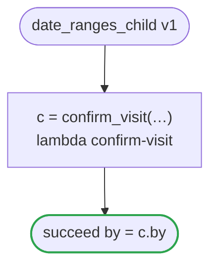

# date_ranges_child v1

Confirms a visit on a day and in a window it holds to ranges of its own: date_ranges.flow runs it as its child, and the checker holds what that passes to them. It runs on every platform

`tests/flows/date_ranges_child.flow` を `dandori doc` で描いたものです。入力は `id: string`・`day: date range >=2026-01-01 <=2027-12-31`・`window: timestamp range >=2026-01-01 <=2027-12-31 offset +09:00`、出力は `by: string` です。

## flow

四角はタスク、両脇に線のある四角は規則、斜めの四角は外から値が届くタスク（イベントやコールバックの応答）、六角形は `match`、角の丸い四角は待ち、ステップを囲む枠はループです。破線の矢印は、呼び出しがその場で処理するエラーです。

## 呼び出し

| 行 | 呼び出し | 呼ぶもの | リトライ | タイムアウト | 失敗したとき |
|---:|---|---|---|---|---|
| 20 | `c = confirm_visit(…)` | `lambda confirm-visit`・`idempotent` | — | — | `timeout`・`failure` → ワークフローが失敗する |

## 終わり方

ワークフローの終わり方のすべてです。

| 行 | 終わり方 |
|---:|---|
| 21 | `succeed by = c.by` |

