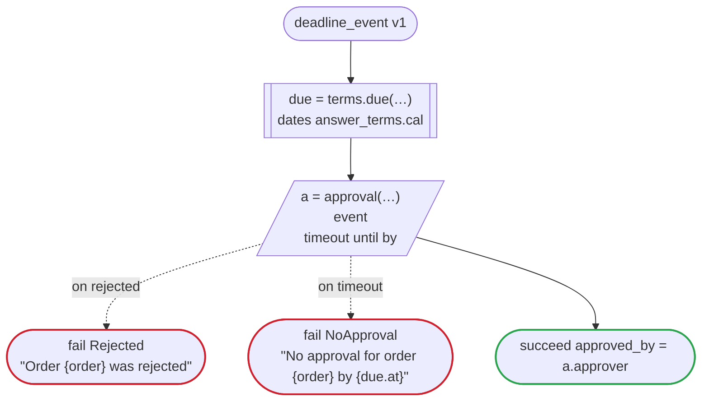

# deadline_event v1

Waits for an event until a time (`timeout until`, Temporal): the approval comes to the workflow by its id, until 17:00 on the second business day after the request. The time is the event task's one parameter, which nothing sends. On the other platforms, E050

`tests/flows/deadline_event.flow`, drawn by `dandori doc`. Inputs: `order: string`. Outputs: `approved_by: string`.

## flow

A rectangle is a task, one with a line down each side a rule or a date of a dates file, a slanted one a task whose value comes from outside (an event, or the answer to a callback), a hexagon a `match`, a rounded box a wait, and a box around steps a loop. A dashed arrow is an error the call handles.

## Calls

| Line | Call | Calls | Retries | Timeout | When it fails |
|---:|---|---|---|---|---|
| 22 | `due = terms.due(…)` | the date `due` of `answer_terms.cal` | 2 times, after 1 second and 2 (failure, timeout) | 10 seconds | `timeout`, `failure` → the workflow fails |
| 23 | `a = approval(…)` | `event` | — | until `due.at` | `rejected` → line 24 `timeout` → line 25 `failure` → the workflow fails |

## Ends

Every way the workflow can end.

| Line | End |
|---:|---|
| 24 | `fail Rejected` "Order {order} was rejected" |
| 25 | `fail NoApproval` "No approval for order {order} by {due.at}" |
| 26 | `succeed approved_by = a.approver` |

