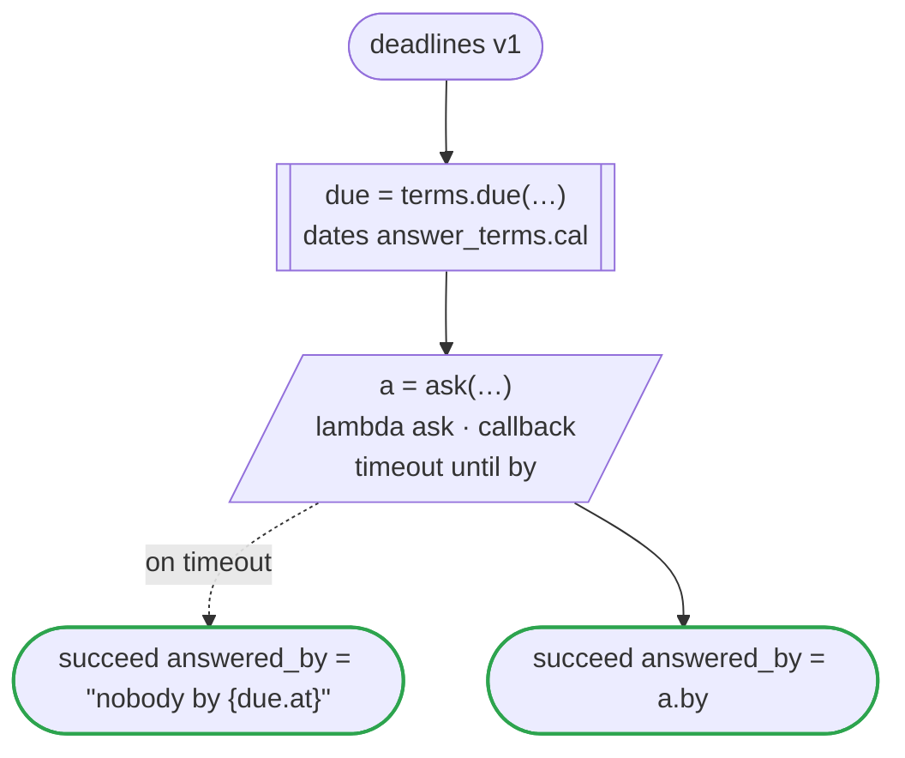

# deadlines v1

Waits for an answer until a time (`timeout until`): a callback whose wait ends at 17:00 on the second business day after the request, a time a dates file gives from `now`. The time goes to the one who answers, with the callback's id. Runs on every platform

`tests/flows/deadlines.flow`, drawn by `dandori doc`. Inputs: `request: string`. Outputs: `answered_by: string`.

## flow

A rectangle is a task, one with a line down each side a rule or a date of a dates file, a slanted one a task whose value comes from outside (an event, or the answer to a callback), a hexagon a `match`, a rounded box a wait, and a box around steps a loop. A dashed arrow is an error the call handles.

## Calls

| Line | Call | Calls | Retries | Timeout | When it fails |
|---:|---|---|---|---|---|
| 23 | `due = terms.due(…)` | the date `due` of `answer_terms.cal` | 2 times, after 1 second and 2 (failure, timeout) | 10 seconds | `timeout`, `failure` → the workflow fails |
| 24 | `a = ask(…)` | `lambda ask · callback` | — | 1 minute to hand the id on, then until `due.at` | `timeout` → line 25 `failure` → the workflow fails |

## Ends

Every way the workflow can end.

| Line | End |
|---:|---|
| 25 | `succeed answered_by = "nobody by {due.at}"` |
| 26 | `succeed answered_by = a.by` |

