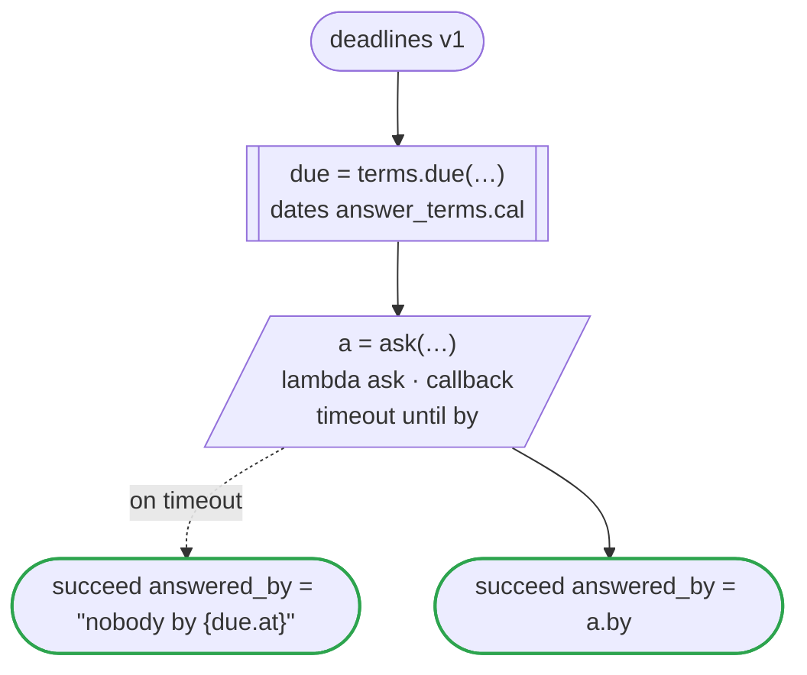

# deadlines v1

Waits for an answer until a time (`timeout until`): a callback whose wait ends at 17:00 on the second business day after the request, a time a dates file gives from `now`. The time goes to the one who answers, with the callback's id. Runs on every platform

`tests/flows/deadlines.flow` を `dandori doc` で描いたものです。入力は `request: string`、出力は `answered_by: string` です。

## flow

四角はタスク、両脇に線のある四角は規則か日付のファイルの日付、斜めの四角は外から値が届くタスク（イベントやコールバックの応答）、六角形は `match`、角の丸い四角は待ち、ステップを囲む枠はループです。破線の矢印は、呼び出しがその場で処理するエラーです。

## 呼び出し

| 行 | 呼び出し | 呼ぶもの | リトライ | タイムアウト | 失敗したとき |
|---:|---|---|---|---|---|
| 23 | `due = terms.due(…)` | `answer_terms.cal` の日付 `due` | 1 秒後と 2 秒後の 2 回（failure・timeout） | 10 秒 | `timeout`・`failure` → ワークフローが失敗する |
| 24 | `a = ask(…)` | `lambda ask · callback` | — | `due.at` まで | `timeout` → 25 行目 `failure` → ワークフローが失敗する |

## 終わり方

ワークフローの終わり方のすべてです。

| 行 | 終わり方 |
|---:|---|
| 25 | `succeed answered_by = "nobody by {due.at}"` |
| 26 | `succeed answered_by = a.by` |

