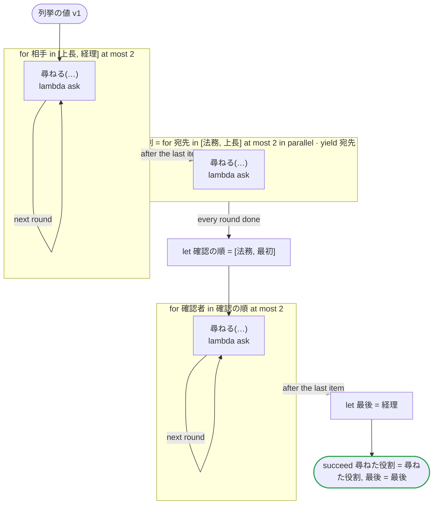

# 列挙の値 v1

型を書いていないところに列挙の値を書く。for が回す並び（一回ずつと、同時に）、型を書かない変数に入れる並び（ほかの要素が型を決める）、型を書かない変数に入れる値。どれも、その名前を値に持つただ一つの列挙の値で、どの出力先のコードもその型を書く。enum_values.flow の日本語の版

`tests/flows/enum_values.ja.flow`, drawn by `dandori doc`. Inputs: `申請番号: string`, `最初: 役割`. Outputs: `尋ねた役割: list[役割]`, `最後: 役割`.

## flow

A rectangle is a task, one with a line down each side a rule, a slanted one a task whose value comes from outside (an event, or the answer to a callback), a hexagon a `match`, a rounded box a wait, and a box around steps a loop. A dashed arrow is an error the call handles.

## Calls

| Line | Call | Calls | Retries | Timeout | When it fails |
|---:|---|---|---|---|---|
| 19 | `尋ねる(…)` | `lambda ask` | — | — | `timeout`, `failure` → the workflow fails |
| 21 | `尋ねる(…)` | `lambda ask` | — | — | `timeout`, `failure` → the round fails, and then the workflow |
| 25 | `尋ねる(…)` | `lambda ask` | — | — | `timeout`, `failure` → the workflow fails |

## Ends

Every way the workflow can end.

| Line | End |
|---:|---|
| 27 | `succeed 尋ねた役割 = 尋ねた役割, 最後 = 最後` |

