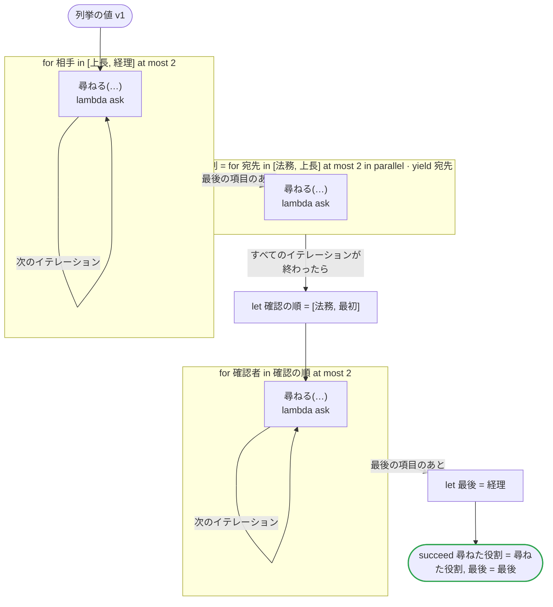

# 列挙の値 v1

型を書いていないところに列挙の値を書く。for が回す並び（一回ずつと、同時に）、型を書かない変数に入れる並び（ほかの要素が型を決める）、型を書かない変数に入れる値。どれも、その名前を値に持つただ一つの列挙の値で、どの出力先のコードもその型を書く。enum_values.flow の日本語の版

`tests/flows/enum_values.ja.flow` を `dandori doc` で描いたものです。入力は `申請番号: string`・`最初: 役割`、出力は `尋ねた役割: list[役割]`・`最後: 役割` です。

## flow

四角はタスク、両脇に線のある四角は規則、斜めの四角は外から値が届くタスク（イベントやコールバックの応答）、六角形は `match`、角の丸い四角は待ち、ステップを囲む枠はループです。破線の矢印は、呼び出しがその場で処理するエラーです。

## 呼び出し

| 行 | 呼び出し | 呼ぶもの | リトライ | タイムアウト | 失敗したとき |
|---:|---|---|---|---|---|
| 19 | `尋ねる(…)` | `lambda ask` | — | — | `timeout`・`failure` → ワークフローが失敗する |
| 21 | `尋ねる(…)` | `lambda ask` | — | — | `timeout`・`failure` → そのイテレーションが失敗し、ワークフローも失敗する |
| 25 | `尋ねる(…)` | `lambda ask` | — | — | `timeout`・`failure` → ワークフローが失敗する |

## 終わり方

ワークフローの終わり方のすべてです。

| 行 | 終わり方 |
|---:|---|
| 27 | `succeed 尋ねた役割 = 尋ねた役割, 最後 = 最後` |

