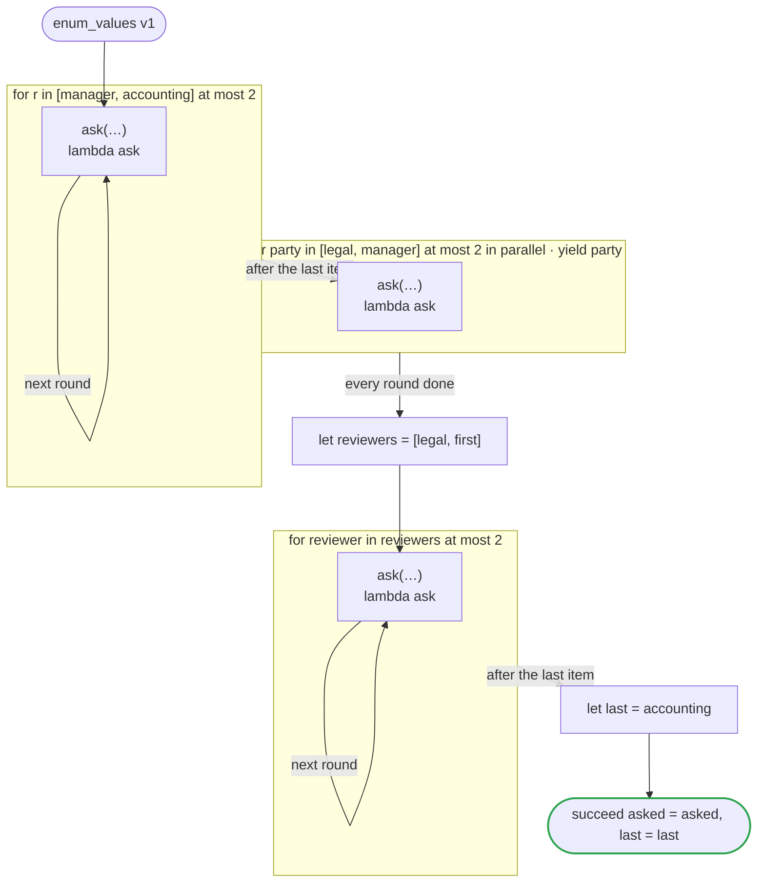

# enum_values v1

Writes values of an enum where nothing says their type: the lists a for goes through, one round after another and in parallel, a list put in a variable with no type, whose other item says its type, and a value put in a variable with no type. Each is a value of the one enum that has it, and the code of every platform writes its type

`tests/flows/enum_values.flow`, drawn by `dandori doc`. Inputs: `claim_id: string`, `first: role`. Outputs: `asked: list[role]`, `last: role`.

## flow

A rectangle is a task, one with a line down each side a rule, a slanted one a task whose value comes from outside (an event, or the answer to a callback), a hexagon a `match`, a rounded box a wait, and a box around steps a loop. A dashed arrow is an error the call handles.

## Calls

| Line | Call | Calls | Retries | Timeout | When it fails |
|---:|---|---|---|---|---|
| 19 | `ask(…)` | `lambda ask` | — | — | `timeout`, `failure` → the workflow fails |
| 21 | `ask(…)` | `lambda ask` | — | — | `timeout`, `failure` → the round fails, and then the workflow |
| 25 | `ask(…)` | `lambda ask` | — | — | `timeout`, `failure` → the workflow fails |

## Ends

Every way the workflow can end.

| Line | End |
|---:|---|
| 27 | `succeed asked = asked, last = last` |

