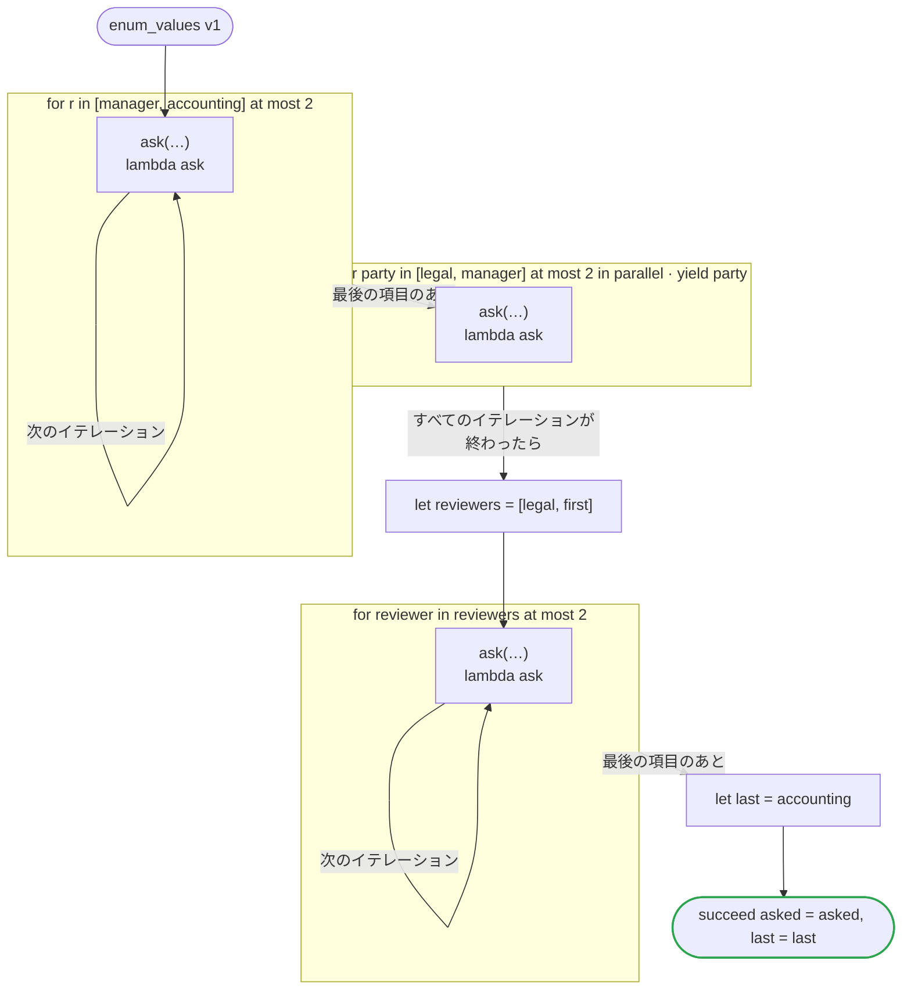

# enum_values v1

Writes values of an enum where nothing says their type: the lists a for goes through, one round after another and in parallel, a list put in a variable with no type, whose other item says its type, and a value put in a variable with no type. Each is a value of the one enum that has it, and the code of every platform writes its type

`tests/flows/enum_values.flow` を `dandori doc` で描いたものです。入力は `claim_id: string`・`first: role`、出力は `asked: list[role]`・`last: role` です。

## flow

四角はタスク、両脇に線のある四角は規則、斜めの四角は外から値が届くタスク（イベントやコールバックの応答）、六角形は `match`、角の丸い四角は待ち、ステップを囲む枠はループです。破線の矢印は、呼び出しがその場で処理するエラーです。

## 呼び出し

| 行 | 呼び出し | 呼ぶもの | リトライ | タイムアウト | 失敗したとき |
|---:|---|---|---|---|---|
| 19 | `ask(…)` | `lambda ask` | — | — | `timeout`・`failure` → ワークフローが失敗する |
| 21 | `ask(…)` | `lambda ask` | — | — | `timeout`・`failure` → そのイテレーションが失敗し、ワークフローも失敗する |
| 25 | `ask(…)` | `lambda ask` | — | — | `timeout`・`failure` → ワークフローが失敗する |

## 終わり方

ワークフローの終わり方のすべてです。

| 行 | 終わり方 |
|---:|---|
| 27 | `succeed asked = asked, last = last` |

