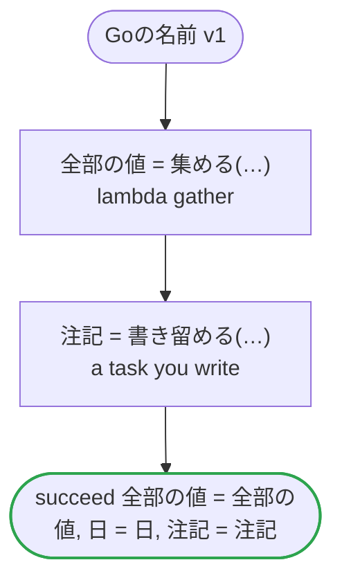

# Goの名前 v1

Go のパッケージが自分のために宣言し、呼ぶ側には知らせない名前を、型に付けたフローです。ワークフローを動かすプログラムが読むワーカーの部品、既定のトランスポート、エージェントのエラー、判断のサービスの置き場、時刻と日付の形を使います。パッケージは自分の名前を別の名前にし、プログラムはその名前を読みます。フローはどのプラットフォームでも動きます

`tests/flows/go_names.ja.flow`, drawn by `dandori doc`. Inputs: `番号: string`, `日: date`. Outputs: `全部の値: 全部`, `日: date`, `注記: string`.

## flow

A rectangle is a task, one with a line down each side a rule, a slanted one a task whose value comes from outside (an event, or the answer to a callback), a hexagon a `match`, a rounded box a wait, and a box around steps a loop. A dashed arrow is an error the call handles.

## Calls

| Line | Call | Calls | Retries | Timeout | When it fails |
|---:|---|---|---|---|---|
| 94 | `全部の値 = 集める(…)` | `lambda gather`, `idempotent` | — | — | `timeout`, `failure` → the workflow fails |
| 95 | `注記 = 書き留める(…)` | a task you write | — | — | `timeout`, `failure` → the workflow fails |

## Ends

Every way the workflow can end.

| Line | End |
|---:|---|
| 96 | `succeed 全部の値 = 全部の値, 日 = 日, 注記 = 注記` |

