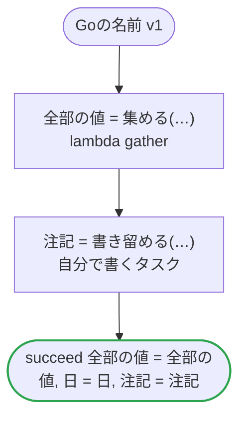

# Goの名前 v1

Go のパッケージが自分のために宣言し、呼ぶ側には知らせない名前を、型に付けたフローです。ワークフローを動かすプログラムが読むワーカーの部品、既定のトランスポート、エージェントのエラー、判断のサービスの置き場、時刻と日付の形を使います。パッケージは自分の名前を別の名前にし、プログラムはその名前を読みます。フローはどのプラットフォームでも動きます

`tests/flows/go_names.ja.flow` を `dandori doc` で描いたものです。入力は `番号: string`・`日: date`、出力は `全部の値: 全部`・`日: date`・`注記: string` です。

## flow

四角はタスク、両脇に線のある四角は規則、斜めの四角は外から値が届くタスク（イベントやコールバックの応答）、六角形は `match`、角の丸い四角は待ち、ステップを囲む枠はループです。破線の矢印は、呼び出しがその場で処理するエラーです。

## 呼び出し

| 行 | 呼び出し | 呼ぶもの | リトライ | タイムアウト | 失敗したとき |
|---:|---|---|---|---|---|
| 94 | `全部の値 = 集める(…)` | `lambda gather`・`idempotent` | — | — | `timeout`・`failure` → ワークフローが失敗する |
| 95 | `注記 = 書き留める(…)` | 自分で書くタスク | — | — | `timeout`・`failure` → ワークフローが失敗する |

## 終わり方

ワークフローの終わり方のすべてです。

| 行 | 終わり方 |
|---:|---|
| 96 | `succeed 全部の値 = 全部の値, 日 = 日, 注記 = 注記` |

