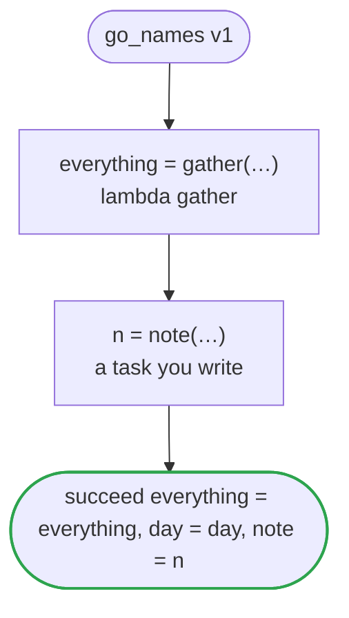

# go_names v1

Types named as what the package of Go declares for its own use and tells no caller of: the parts of the worker that a program running the workflow reads, the default transport, the errors of an agent, the places of the decision services, and the patterns of a time and of a date. The package gives its own other names, which the program reads, and the flow runs on every platform

`tests/flows/go_names.flow`, drawn by `dandori doc`. Inputs: `id: string`, `day: date`. Outputs: `everything: Everything`, `day: date`, `note: string`.

## flow

A rectangle is a task, one with a line down each side a rule, a slanted one a task whose value comes from outside (an event, or the answer to a callback), a hexagon a `match`, a rounded box a wait, and a box around steps a loop. A dashed arrow is an error the call handles.

## Calls

| Line | Call | Calls | Retries | Timeout | When it fails |
|---:|---|---|---|---|---|
| 94 | `everything = gather(…)` | `lambda gather`, `idempotent` | — | — | `timeout`, `failure` → the workflow fails |
| 95 | `n = note(…)` | a task you write | — | — | `timeout`, `failure` → the workflow fails |

## Ends

Every way the workflow can end.

| Line | End |
|---:|---|
| 96 | `succeed everything = everything, day = day, note = n` |

