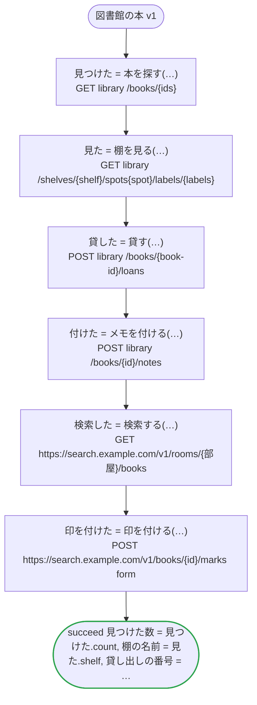

# 図書館の本 v1

図書館の本を探し、棚の場所を見て、本を貸し、メモを付ける。引数は、記述が言う置き場と書き方で送る。記述の無い検索と印付けは、既定の形で送る

`tests/flows/http_places.ja.flow`, drawn by `dandori doc`. Inputs: `棚: string`, `借りる人: string`, `返す日: date`, `メモ: string?`, `トレース: string?`, `備考: string?`. Outputs: `見つけた数: int range >=0 <=1000`, `棚の名前: string`, `貸し出しの番号: string`, `メモの番号: string`, `検索の数: int range >=0 <=1000`, `印の番号: string`.

## flow

A rectangle is a task, one with a line down each side a rule, a slanted one a task whose value comes from outside (an event, or the answer to a callback), a hexagon a `match`, a rounded box a wait, and a box around steps a loop. A dashed arrow is an error the call handles.

## Calls

| Line | Call | Calls | Retries | Timeout | When it fails |
|---:|---|---|---|---|---|
| 106 | `見つけた = 本を探す(…)` | `GET library /books/{ids}`, `idempotent` | — | — | `timeout`, `failure` → the workflow fails |
| 107 | `見た = 棚を見る(…)` | `GET library /shelves/{shelf}/spots{spot}/labels/{labels}`, `idempotent` | — | — | `timeout`, `failure` → the workflow fails |
| 108 | `貸した = 貸す(…)` | `POST library /books/{book-id}/loans` | — | — | `timeout`, `failure` → the workflow fails |
| 109 | `付けた = メモを付ける(…)` | `POST library /books/{id}/notes` | — | — | `timeout`, `failure` → the workflow fails |
| 110 | `検索した = 検索する(…)` | `GET https://search.example.com/v1/rooms/{部屋}/books`, `idempotent` | — | — | `timeout`, `failure` → the workflow fails |
| 111 | `印を付けた = 印を付ける(…)` | `POST https://search.example.com/v1/books/{id}/marks form` | — | — | `timeout`, `failure` → the workflow fails |

## Ends

Every way the workflow can end.

| Line | End |
|---:|---|
| 112 | `succeed 見つけた数 = 見つけた.count, 棚の名前 = 見た.shelf, 貸し出しの番号 = 貸した.id, メモの番号 = 付けた.id, 検索の数 = 検索した.count, 印の番号 = 印を付けた.id` |

