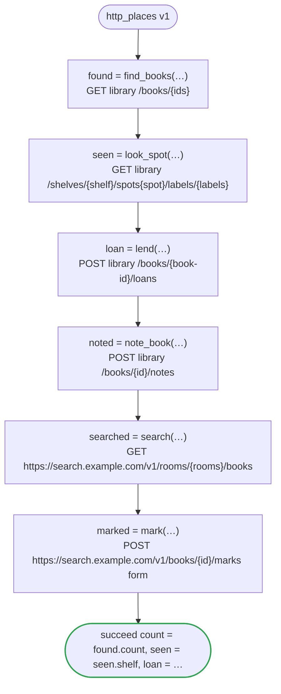

# http_places v1

Find a library's books, look at a spot on a shelf, lend a book and note it, where each argument goes to the place and in the style the library's description says, and search and mark books where no description says

`tests/flows/http_places.flow`, drawn by `dandori doc`. Inputs: `shelf: string`, `reader: string`, `due: date`, `note: string?`, `trace: string?`, `memo: string?`. Outputs: `count: int range >=0 <=1000`, `seen: string`, `loan: string`, `noted: string`, `found: int range >=0 <=1000`, `marked: string`.

## flow

A rectangle is a task, one with a line down each side a rule, a slanted one a task whose value comes from outside (an event, or the answer to a callback), a hexagon a `match`, a rounded box a wait, and a box around steps a loop. A dashed arrow is an error the call handles.

## Calls

| Line | Call | Calls | Retries | Timeout | When it fails |
|---:|---|---|---|---|---|
| 99 | `found = find_books(…)` | `GET library /books/{ids}`, `idempotent` | — | — | `timeout`, `failure` → the workflow fails |
| 100 | `seen = look_spot(…)` | `GET library /shelves/{shelf}/spots{spot}/labels/{labels}`, `idempotent` | — | — | `timeout`, `failure` → the workflow fails |
| 101 | `loan = lend(…)` | `POST library /books/{book-id}/loans` | — | — | `timeout`, `failure` → the workflow fails |
| 102 | `noted = note_book(…)` | `POST library /books/{id}/notes` | — | — | `timeout`, `failure` → the workflow fails |
| 103 | `searched = search(…)` | `GET https://search.example.com/v1/rooms/{rooms}/books`, `idempotent` | — | — | `timeout`, `failure` → the workflow fails |
| 104 | `marked = mark(…)` | `POST https://search.example.com/v1/books/{id}/marks form` | — | — | `timeout`, `failure` → the workflow fails |

## Ends

Every way the workflow can end.

| Line | End |
|---:|---|
| 105 | `succeed count = found.count, seen = seen.shelf, loan = loan.id, noted = noted.id, found = searched.count, marked = marked.id` |

