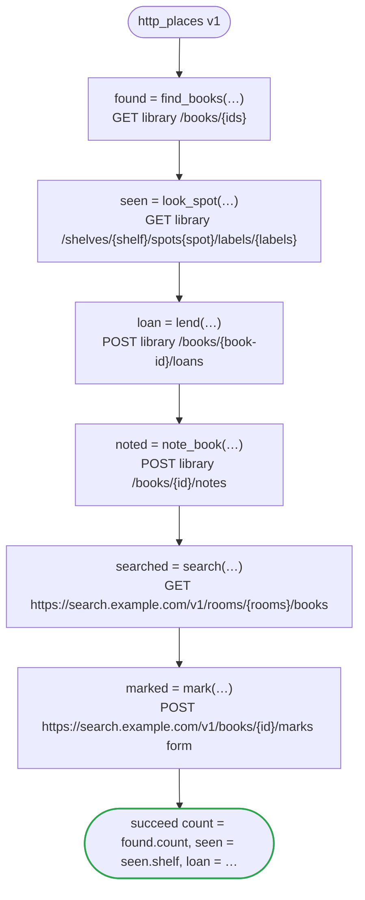

# http_places v1

Find a library's books, look at a spot on a shelf, lend a book and note it, where each argument goes to the place and in the style the library's description says, and search and mark books where no description says

`tests/flows/http_places.flow` を `dandori doc` で描いたものです。入力は `shelf: string`・`reader: string`・`due: date`・`note: string?`・`trace: string?`・`memo: string?`、出力は `count: int range >=0 <=1000`・`seen: string`・`loan: string`・`noted: string`・`found: int range >=0 <=1000`・`marked: string` です。

## flow

四角はタスク、両脇に線のある四角は規則、斜めの四角は外から値が届くタスク（イベントやコールバックの応答）、六角形は `match`、角の丸い四角は待ち、ステップを囲む枠はループです。破線の矢印は、呼び出しがその場で処理するエラーです。

## 呼び出し

| 行 | 呼び出し | 呼ぶもの | リトライ | タイムアウト | 失敗したとき |
|---:|---|---|---|---|---|
| 99 | `found = find_books(…)` | `GET library /books/{ids}`・`idempotent` | — | — | `timeout`・`failure` → ワークフローが失敗する |
| 100 | `seen = look_spot(…)` | `GET library /shelves/{shelf}/spots{spot}/labels/{labels}`・`idempotent` | — | — | `timeout`・`failure` → ワークフローが失敗する |
| 101 | `loan = lend(…)` | `POST library /books/{book-id}/loans` | — | — | `timeout`・`failure` → ワークフローが失敗する |
| 102 | `noted = note_book(…)` | `POST library /books/{id}/notes` | — | — | `timeout`・`failure` → ワークフローが失敗する |
| 103 | `searched = search(…)` | `GET https://search.example.com/v1/rooms/{rooms}/books`・`idempotent` | — | — | `timeout`・`failure` → ワークフローが失敗する |
| 104 | `marked = mark(…)` | `POST https://search.example.com/v1/books/{id}/marks form` | — | — | `timeout`・`failure` → ワークフローが失敗する |

## 終わり方

ワークフローの終わり方のすべてです。

| 行 | 終わり方 |
|---:|---|
| 105 | `succeed count = found.count, seen = seen.shelf, loan = loan.id, noted = noted.id, found = searched.count, marked = marked.id` |

