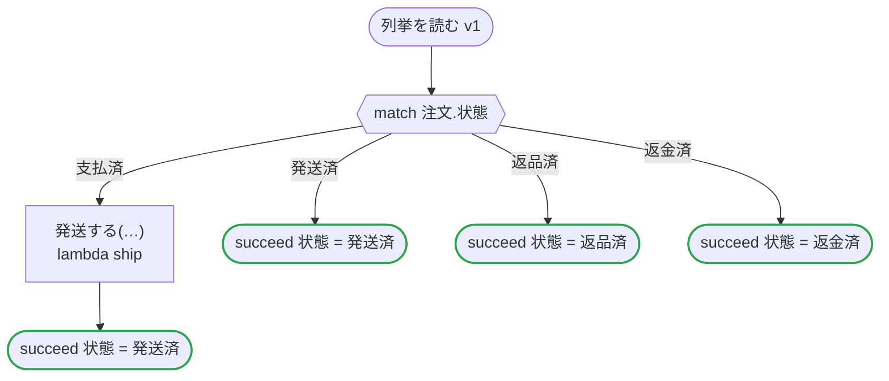

# 列挙を読む v1

注文の状態と顧客の段階を enums のファイルから import enum で読み、自分で書いた列挙として使う。状態への match、状態を持つレコード、順のある段階への範囲。どの出力先のコードも、同じ列挙をフローに書いたときのコードと同じ。import_enum.flow の日本語の版

`tests/flows/import_enum.ja.flow`, drawn by `dandori doc`. Inputs: `注文: 注文`, `等級: 等級 range >=基本 <=銀`. Outputs: `状態: 注文の状態`.

## flow

A rectangle is a task, one with a line down each side a rule, a slanted one a task whose value comes from outside (an event, or the answer to a callback), a hexagon a `match`, a rounded box a wait, and a box around steps a loop. A dashed arrow is an error the call handles.

## Calls

| Line | Call | Calls | Retries | Timeout | When it fails |
|---:|---|---|---|---|---|
| 24 | `発送する(…)` | `lambda ship` | — | — | `timeout`, `failure` → the workflow fails |

## Ends

Every way the workflow can end.

| Line | End |
|---:|---|
| 25 | `succeed 状態 = 発送済` |
| 26 | `succeed 状態 = 発送済` |
| 27 | `succeed 状態 = 返品済` |
| 28 | `succeed 状態 = 返金済` |

## Enums read from other files

The enums `import enum` reads from `enums` files. Their values are the file's, used as an enum written in the flow is; when the file adds a value or renames one, `dandori check` reads it again.

| Enum | Values | File | Name there | Ordered |
|---|---|---|---|---|
| `注文の状態` | `支払済`, `発送済`, `返品済`, `返金済` | `rules/注文の状態の列挙.rule` | `注文の状態` | no |
| `等級` | `基本`, `銀`, `金` | `rules/注文の状態の列挙.rule` | `段階` | yes |

