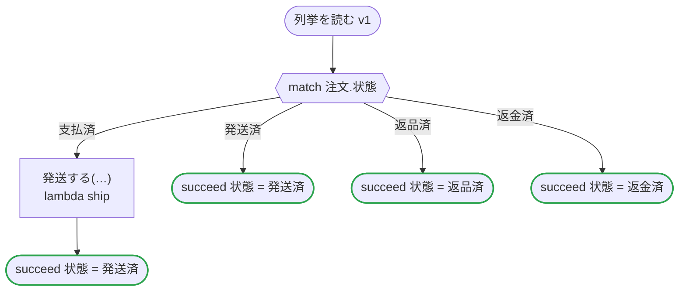

# 列挙を読む v1

注文の状態と顧客の段階を enums のファイルから import enum で読み、自分で書いた列挙として使う。状態への match、状態を持つレコード、順のある段階への範囲。どの出力先のコードも、同じ列挙をフローに書いたときのコードと同じ。import_enum.flow の日本語の版

`tests/flows/import_enum.ja.flow` を `dandori doc` で描いたものです。入力は `注文: 注文`・`等級: 等級 range >=基本 <=銀`、出力は `状態: 注文の状態` です。

## flow

四角はタスク、両脇に線のある四角は規則、斜めの四角は外から値が届くタスク（イベントやコールバックの応答）、六角形は `match`、角の丸い四角は待ち、ステップを囲む枠はループです。破線の矢印は、呼び出しがその場で処理するエラーです。

## 呼び出し

| 行 | 呼び出し | 呼ぶもの | リトライ | タイムアウト | 失敗したとき |
|---:|---|---|---|---|---|
| 24 | `発送する(…)` | `lambda ship` | — | — | `timeout`・`failure` → ワークフローが失敗する |

## 終わり方

ワークフローの終わり方のすべてです。

| 行 | 終わり方 |
|---:|---|
| 25 | `succeed 状態 = 発送済` |
| 26 | `succeed 状態 = 発送済` |
| 27 | `succeed 状態 = 返品済` |
| 28 | `succeed 状態 = 返金済` |

## ほかのファイルから読んだ列挙

`import enum` で、`enums` ファイルから読んだ列挙です。値は、そのファイルの列挙が持つものを、flow に書いた列挙と同じに使います。そのファイルで値を足したり名前を変えたりすると、`dandori check` はそれを読み直します。

| 列挙 | 値 | ファイル | そこでの名前 | 順 |
|---|---|---|---|---|
| `注文の状態` | `支払済`・`発送済`・`返品済`・`返金済` | `rules/注文の状態の列挙.rule` | `注文の状態` | なし |
| `等級` | `基本`・`銀`・`金` | `rules/注文の状態の列挙.rule` | `段階` | あり |

