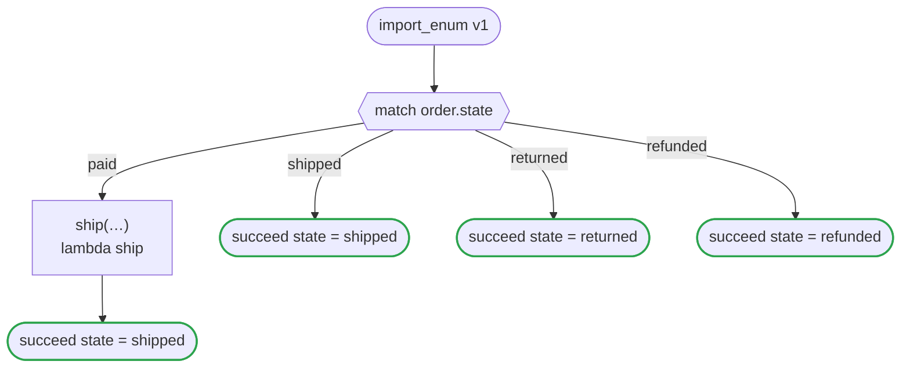

# import_enum v1

Reads the states of an order and the tiers of a customer from an enums file with import enum, and uses them as enums it writes itself: a match over the states, a record that holds one, a range over the ordered tiers. The code of every platform is the code of the same enums written in the flow

`tests/flows/import_enum.flow`, drawn by `dandori doc`. Inputs: `order: Order`, `grade: grade range >=basic <=silver`. Outputs: `state: order_state`.

## flow

A rectangle is a task, one with a line down each side a rule, a slanted one a task whose value comes from outside (an event, or the answer to a callback), a hexagon a `match`, a rounded box a wait, and a box around steps a loop. A dashed arrow is an error the call handles.

## Calls

| Line | Call | Calls | Retries | Timeout | When it fails |
|---:|---|---|---|---|---|
| 24 | `ship(…)` | `lambda ship` | — | — | `timeout`, `failure` → the workflow fails |

## Ends

Every way the workflow can end.

| Line | End |
|---:|---|
| 25 | `succeed state = shipped` |
| 26 | `succeed state = shipped` |
| 27 | `succeed state = returned` |
| 28 | `succeed state = refunded` |

## Enums read from other files

The enums `import enum` reads from `enums` files. Their values are the file's, used as an enum written in the flow is; when the file adds a value or renames one, `dandori check` reads it again.

| Enum | Values | File | Name there | Ordered |
|---|---|---|---|---|
| `order_state` | `paid`, `shipped`, `returned`, `refunded` | `rules/import_enum_states.rule` | `order_state` | no |
| `grade` | `basic`, `silver`, `gold` | `rules/import_enum_states.rule` | `tier` | yes |

