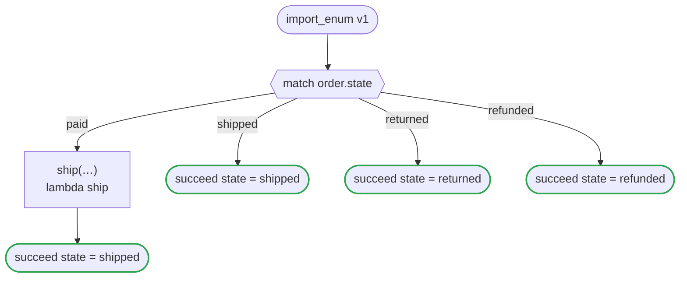

# import_enum v1

Reads the states of an order and the tiers of a customer from an enums file with import enum, and uses them as enums it writes itself: a match over the states, a record that holds one, a range over the ordered tiers. The code of every platform is the code of the same enums written in the flow

`tests/flows/import_enum.flow` を `dandori doc` で描いたものです。入力は `order: Order`・`grade: grade range >=basic <=silver`、出力は `state: order_state` です。

## flow

四角はタスク、両脇に線のある四角は規則、斜めの四角は外から値が届くタスク（イベントやコールバックの応答）、六角形は `match`、角の丸い四角は待ち、ステップを囲む枠はループです。破線の矢印は、呼び出しがその場で処理するエラーです。

## 呼び出し

| 行 | 呼び出し | 呼ぶもの | リトライ | タイムアウト | 失敗したとき |
|---:|---|---|---|---|---|
| 24 | `ship(…)` | `lambda ship` | — | — | `timeout`・`failure` → ワークフローが失敗する |

## 終わり方

ワークフローの終わり方のすべてです。

| 行 | 終わり方 |
|---:|---|
| 25 | `succeed state = shipped` |
| 26 | `succeed state = shipped` |
| 27 | `succeed state = returned` |
| 28 | `succeed state = refunded` |

## ほかのファイルから読んだ列挙

`import enum` で、`enums` ファイルから読んだ列挙です。値は、そのファイルの列挙が持つものを、flow に書いた列挙と同じに使います。そのファイルで値を足したり名前を変えたりすると、`dandori check` はそれを読み直します。

| 列挙 | 値 | ファイル | そこでの名前 | 順 |
|---|---|---|---|---|
| `order_state` | `paid`・`shipped`・`returned`・`refunded` | `rules/import_enum_states.rule` | `order_state` | なし |
| `grade` | `basic`・`silver`・`gold` | `rules/import_enum_states.rule` | `tier` | あり |

