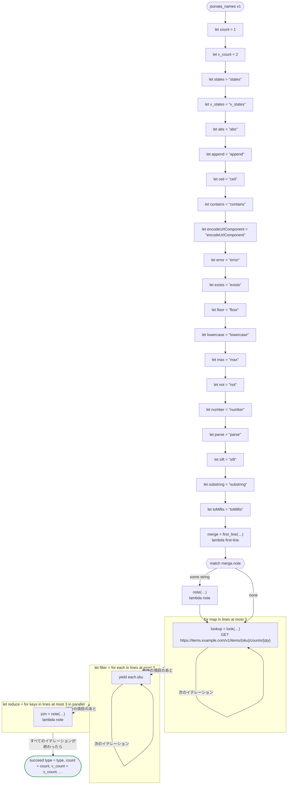

# jsonata_names v1

A variable for each function of JSONata the state machine calls, and the input `type`: no variable hides a function, and the input keeps its key in JSON. `v_count` and `v_states` are variables of their own beside `count` and `states`. Runs on every platform

`tests/flows/jsonata_names.flow` を `dandori doc` で描いたものです。入力は `type: string`・`lines: list[Line]`、出力は `type: string`・`count: int`・`v_count: int`・`states: string`・`v_states: string`・`skus: list[string]`・`notes: list[string]`・`text: string` です。

## flow

四角はタスク、両脇に線のある四角は規則、斜めの四角は外から値が届くタスク（イベントやコールバックの応答）、六角形は `match`、角の丸い四角は待ち、ステップを囲む枠はループです。破線の矢印は、呼び出しがその場で処理するエラーです。

## 呼び出し

| 行 | 呼び出し | 呼ぶもの | リトライ | タイムアウト | 失敗したとき |
|---:|---|---|---|---|---|
| 60 | `merge = first_line(…)` | `lambda first-line`・`idempotent` | — | — | `timeout`・`failure` → ワークフローが失敗する |
| 62 | `note(…)` | `lambda note`・`idempotent` | — | — | `timeout`・`failure` → ワークフローが失敗する |
| 65 | `lookup = look(…)` | `GET https://items.example.com/v1/items/{sku}/counts/{qty}`・`idempotent` | — | — | `timeout`・`failure` → ワークフローが失敗する |
| 69 | `join = note(…)` | `lambda note`・`idempotent` | — | — | `timeout`・`failure` → そのイテレーションが失敗し、ワークフローも失敗する |

## 終わり方

ワークフローの終わり方のすべてです。

| 行 | 終わり方 |
|---:|---|
| 71 | `succeed type = type, count = count, v_count = v_count, states = states, v_states = v_states, skus = filter, notes = reduce, text = "{abs}{append}{ceil}{contains}{encodeUrlComponent}{error}{exists}{floor}{lowercase}{max}{not}{number}{parse}{sift}{substring}{toMillis}"` |

