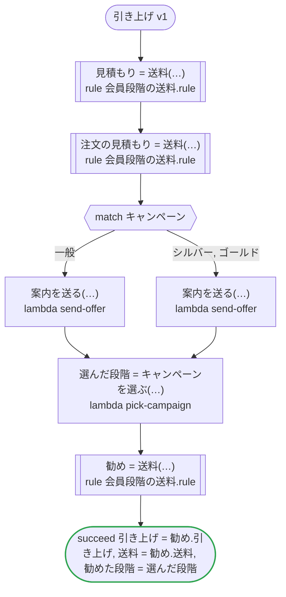

# 引き上げ v1

キャンペーンは、その注文に限って会員の段階を引き上げる。引き上げられるのは、規則が受け付けるゴールドまで。ワークフローは、受け取ったキャンペーン、注文のキャンペーン、タスクが選んだキャンペーンを、入ってくるところでその範囲に収め、そのまま規則に渡す。どのプラットフォームでも走る

`tests/flows/lift.ja.flow`, drawn by `dandori doc`. Inputs: `会員: 送料.段階`, `キャンペーン: 送料.段階 range >=一般 <=ゴールド`, `注文: 注文`. Outputs: `引き上げ: bool`, `送料: money[USD]`, `勧めた段階: 送料.段階 range >=シルバー <=ゴールド`.

## flow

A rectangle is a task, one with a line down each side a rule, a slanted one a task whose value comes from outside (an event, or the answer to a callback), a hexagon a `match`, a rounded box a wait, and a box around steps a loop. A dashed arrow is an error the call handles.

## Calls

| Line | Call | Calls | Retries | Timeout | When it fails |
|---:|---|---|---|---|---|
| 32 | `見積もり = 送料(…)` | rule `会員段階の送料.rule` | 2 times, after 1 second and 2 (failure, timeout) | 10 seconds | `timeout`, `failure` → the workflow fails |
| 34 | `注文の見積もり = 送料(…)` | rule `会員段階の送料.rule` | 2 times, after 1 second and 2 (failure, timeout) | 10 seconds | `timeout`, `failure` → the workflow fails |
| 37 | `案内を送る(…)` | `lambda send-offer`, `key` | — | — | `timeout`, `failure` → the workflow fails |
| 38 | `案内を送る(…)` | `lambda send-offer`, `key` | — | — | `timeout`, `failure` → the workflow fails |
| 40 | `選んだ段階 = キャンペーンを選ぶ(…)` | `lambda pick-campaign`, `idempotent` | — | — | `timeout`, `failure` → the workflow fails |
| 41 | `勧め = 送料(…)` | rule `会員段階の送料.rule` | 2 times, after 1 second and 2 (failure, timeout) | 10 seconds | `timeout`, `failure` → the workflow fails |

## Ends

Every way the workflow can end.

| Line | End |
|---:|---|
| 42 | `succeed 引き上げ = 勧め.引き上げ, 送料 = 勧め.送料, 勧めた段階 = 選んだ段階` |

## Rules

The rules this workflow calls, each as the page for people that `rulec doc` renders.

<code>送料</code> · 会員段階の送料 v1 · <code>rules/会員段階の送料.rule</code>

<!-- Generated by rulec 0.36.0 from 会員段階の送料.rule (sha256:47f5aaf0268e). This is a read-only rendering; the source of truth is the .rule file. Edits cannot be carried back. -->
# Rule 会員段階の送料 v1

会員の段階で決まる送料。ゴールドから上は無料で、キャンペーンはその注文に限って会員をキャンペーンの段階まで引き上げる

## Inputs

| Name | Type | Range | Notes |
|---|---|---|---|
| 会員 | 段階 (4 values) |  | 会員自身の段階 |
| キャンペーン | 段階 (4 values) | 一般 to ゴールド | キャンペーンが引き上げるのはゴールドまで |
| 小計 | money[USD] | 0USD to 100_000USD |  |

## Outputs

| Name | Type | Rounding | Notes |
|---|---|---|---|
| 送料 | money[USD] | down(1USD) |  |
| 適用段階 | 段階 (4 values) |  |  |
| 引き上げ | bool |  |  |

## Types

An enum is a **closed** finite set. Add a value, and every table that does not look at it fails the completeness check.

- **段階** (4 values) — 一般 < シルバー < ゴールド < プラチナ
  - The values are ordered as listed. A cell's `<ゴールド` is "before ゴールド", and `>=ゴールド` is "ゴールド and after".

## Derived Values and Definitions

Intermediate values that can be placed in a table column. The expressions are as written in the source file, and the ranges are the declared ones.

| Name | Kind | Expression | Range | Notes |
|---|---|---|---|---|
| 適用段階 | Definition | `max(会員, キャンペーン)` |  |  |
| 引き上げ | Definition | `キャンペーン > 会員` |  |  |

## Table 送料表 (policy unique)

| Column | Source |
|---|---|
| 適用段階 | Definition |
| 小計 | Input |
| → 送料 | Output of this rule |

| # | 適用段階 | 小計 | → 送料 (money[USD] / down(1USD)) |
|---|---|---|---|
| 1 | >=ゴールド | - | 0USD |
| 2 | シルバー | >=50USD | 0USD |
| 3 | シルバー | <50USD | 5USD |
| 4 | 一般 | >=100USD | 0USD |
| 5 | 一般 | <100USD | 8USD |

**What `rulec check` verified**

- Every combination of inputs matches some row (E101 completeness)
- There is no row that can never match (E102 unreachable row)
- No input matches two or more rows at once (E105 overlap). Reordering the rows does not change the meaning

## Examples (verified)

| 会員 | キャンペーン | 小計 | → 送料 | 適用段階 | 引き上げ |
|---|---|---|---|---|---|
| プラチナ | 一般 | 10USD | 0USD | プラチナ | false |
| 一般 | ゴールド | 10USD | 0USD | ゴールド | true |
| シルバー | 一般 | 60USD | 0USD | シルバー | false |
| シルバー | シルバー | 10USD | 5USD | シルバー | false |
| 一般 | 一般 | 99USD | 8USD | 一般 | false |

`rulec check` ran these 5 examples through the reference evaluator, and every one produced the declared values (E107). The examples are an **executable specification**.

