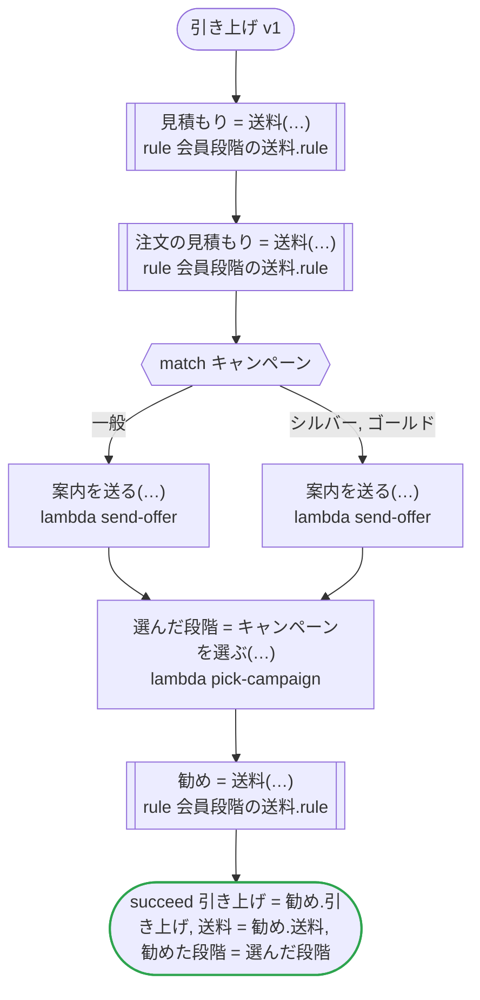

# 引き上げ v1

キャンペーンは、その注文に限って会員の段階を引き上げる。引き上げられるのは、規則が受け付けるゴールドまで。ワークフローは、受け取ったキャンペーン、注文のキャンペーン、タスクが選んだキャンペーンを、入ってくるところでその範囲に収め、そのまま規則に渡す。どのプラットフォームでも走る

`tests/flows/lift.ja.flow` を `dandori doc` で描いたものです。入力は `会員: 送料.段階`・`キャンペーン: 送料.段階 range >=一般 <=ゴールド`・`注文: 注文`、出力は `引き上げ: bool`・`送料: money[USD]`・`勧めた段階: 送料.段階 range >=シルバー <=ゴールド` です。

## flow

四角はタスク、両脇に線のある四角は規則、斜めの四角は外から値が届くタスク（イベントやコールバックの応答）、六角形は `match`、角の丸い四角は待ち、ステップを囲む枠はループです。破線の矢印は、呼び出しがその場で処理するエラーです。

## 呼び出し

| 行 | 呼び出し | 呼ぶもの | リトライ | タイムアウト | 失敗したとき |
|---:|---|---|---|---|---|
| 32 | `見積もり = 送料(…)` | 規則 `会員段階の送料.rule` | 1 秒後と 2 秒後の 2 回（failure・timeout） | 10 秒 | `timeout`・`failure` → ワークフローが失敗する |
| 34 | `注文の見積もり = 送料(…)` | 規則 `会員段階の送料.rule` | 1 秒後と 2 秒後の 2 回（failure・timeout） | 10 秒 | `timeout`・`failure` → ワークフローが失敗する |
| 37 | `案内を送る(…)` | `lambda send-offer`・`key` | — | — | `timeout`・`failure` → ワークフローが失敗する |
| 38 | `案内を送る(…)` | `lambda send-offer`・`key` | — | — | `timeout`・`failure` → ワークフローが失敗する |
| 40 | `選んだ段階 = キャンペーンを選ぶ(…)` | `lambda pick-campaign`・`idempotent` | — | — | `timeout`・`failure` → ワークフローが失敗する |
| 41 | `勧め = 送料(…)` | 規則 `会員段階の送料.rule` | 1 秒後と 2 秒後の 2 回（failure・timeout） | 10 秒 | `timeout`・`failure` → ワークフローが失敗する |

## 終わり方

ワークフローの終わり方のすべてです。

| 行 | 終わり方 |
|---:|---|
| 42 | `succeed 引き上げ = 勧め.引き上げ, 送料 = 勧め.送料, 勧めた段階 = 選んだ段階` |

## 規則

このワークフローが呼ぶ規則です。`rulec doc` が描いた、人が読むページをそのまま載せています。

<code>送料</code> · 会員段階の送料 v1 · <code>rules/会員段階の送料.rule</code>

<!-- rulec 0.38.0 が 会員段階の送料.rule (sha256:47f5aaf0268e) から生成した資料です。読むためのもので、もとになるのは .rule のほうです。ここを編集しても .rule には戻せません。 -->
# 規則 会員段階の送料 v1

会員の段階で決まる送料。ゴールドから上は無料で、キャンペーンはその注文に限って会員をキャンペーンの段階まで引き上げる

## 入力

| 名前 | 型 | 範囲 | 注記 |
|---|---|---|---|
| 会員 | 段階（4 値） |  | 会員自身の段階 |
| キャンペーン | 段階（4 値） | 一般 〜 ゴールド | キャンペーンが引き上げるのはゴールドまで |
| 小計 | money[USD] | 0USD 〜 10万USD |  |

## 出力

| 名前 | 型 | 丸め | 注記 |
|---|---|---|---|
| 送料 | money[USD] | down(1USD) |  |
| 適用段階 | 段階（4 値） |  |  |
| 引き上げ | bool |  |  |

## 型

列挙は**閉じた**有限集合です。値を足すと、その値を扱っていない表は完全性の検査を通らなくなります。

- **段階**（4 値）— 一般 < シルバー < ゴールド < プラチナ
  - 値はこの順に並びます。セルの `<ゴールド` は「ゴールド より前」、`>=ゴールド` は「ゴールド から後」です。

## 導出と定義

表の列に置ける中間の値です。式はもとの規則のとおりで、範囲は宣言されたものです。

| 名前 | 種類 | 式 | 範囲 | 注記 |
|---|---|---|---|---|
| 適用段階 | 定義 | `max(会員, キャンペーン)` |  |  |
| 引き上げ | 定義 | `キャンペーン > 会員` |  |  |

## 表 送料表（policy unique）

| 列 | 出どころ |
|---|---|
| 適用段階 | 定義 |
| 小計 | 入力 |
| → 送料 | この規則の出力 |

| # | 適用段階 | 小計 | → 送料（money[USD] / down(1USD)） |
|---|---|---|---|
| 1 | >=ゴールド | - | 0USD |
| 2 | シルバー | >=50USD | 0USD |
| 3 | シルバー | <50USD | 5USD |
| 4 | 一般 | >=100USD | 0USD |
| 5 | 一般 | <100USD | 8USD |

**`rulec check` が確かめたこと**

- どの入力の組合せも、いずれかの行に当てはまります（E101 完全性）
- どの入力にも当てはまらない行はありません（E102）
- 二つ以上の行に同時に当てはまる入力はありません（E105 重なり）。行の並べ替えは意味を変えません

## 例（検証済み）

| 会員 | キャンペーン | 小計 | → 送料 | 適用段階 | 引き上げ |
|---|---|---|---|---|---|
| プラチナ | 一般 | 10USD | 0USD | プラチナ | false |
| 一般 | ゴールド | 10USD | 0USD | ゴールド | true |
| シルバー | 一般 | 60USD | 0USD | シルバー | false |
| シルバー | シルバー | 10USD | 5USD | シルバー | false |
| 一般 | 一般 | 99USD | 8USD | 一般 | false |

この 5 件は `rulec check` が参照評価器で実行し、すべて宣言どおりの値になりました（E107）。例は**実行される仕様**です。

