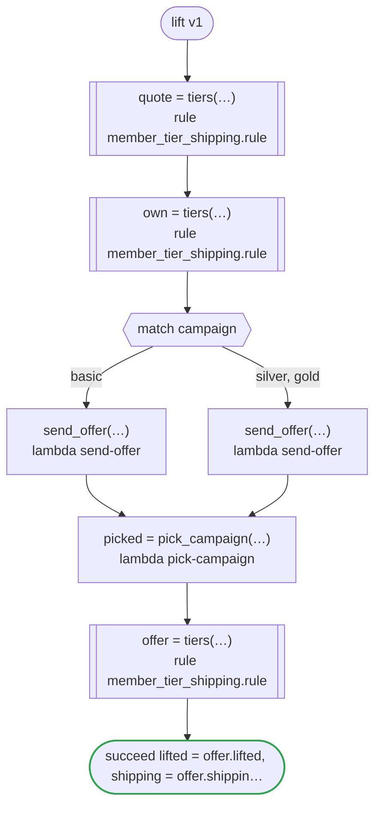

# lift v1

A campaign lifts a member's tier for one order, as far as the rule lets it: gold. The workflow holds what it is given to that range where it comes in (the campaign it is given, the campaign of the order, and the one a task picks), and hands each to the rule as it is. Runs on every platform

`tests/flows/lift.flow`, drawn by `dandori doc`. Inputs: `member: tiers.tier`, `campaign: tiers.tier range >=basic <=gold`, `order: Order`. Outputs: `lifted: bool`, `shipping: money[USD]`, `offered: tiers.tier range >=silver <=gold`.

## flow

A rectangle is a task, one with a line down each side a rule, a slanted one a task whose value comes from outside (an event, or the answer to a callback), a hexagon a `match`, a rounded box a wait, and a box around steps a loop. A dashed arrow is an error the call handles.

## Calls

| Line | Call | Calls | Retries | Timeout | When it fails |
|---:|---|---|---|---|---|
| 32 | `quote = tiers(…)` | rule `member_tier_shipping.rule` | 2 times, after 1 second and 2 (failure) | — | `timeout`, `failure` → the workflow fails |
| 34 | `own = tiers(…)` | rule `member_tier_shipping.rule` | 2 times, after 1 second and 2 (failure) | — | `timeout`, `failure` → the workflow fails |
| 37 | `send_offer(…)` | `lambda send-offer`, `key` | — | — | `timeout`, `failure` → the workflow fails |
| 38 | `send_offer(…)` | `lambda send-offer`, `key` | — | — | `timeout`, `failure` → the workflow fails |
| 40 | `picked = pick_campaign(…)` | `lambda pick-campaign`, `idempotent` | — | — | `timeout`, `failure` → the workflow fails |
| 41 | `offer = tiers(…)` | rule `member_tier_shipping.rule` | 2 times, after 1 second and 2 (failure) | — | `timeout`, `failure` → the workflow fails |

## Ends

Every way the workflow can end.

| Line | End |
|---:|---|
| 42 | `succeed lifted = offer.lifted, shipping = offer.shipping, offered = picked` |

## Rules

The rules this workflow calls, each as the page for people that `rulec doc` renders.

<code>tiers</code> · member_tier_shipping v1 · <code>rules/member_tier_shipping.rule</code>

<!-- Generated by rulec 0.34.1 from member_tier_shipping.rule (sha256:01d90343a970). This is a read-only rendering; the source of truth is the .rule file. Edits cannot be carried back. -->
# Rule member_tier_shipping v1

Shipping by membership tier: gold and above ship free, and a campaign lifts a member to the campaign's tier for that order alone

## Inputs

| Name | Type | Range | Notes |
|---|---|---|---|
| member | tier (4 values) |  | the member's own tier |
| campaign | tier (4 values) | basic to gold | a campaign lifts a member as far as gold |
| subtotal | money[USD] | 0USD to 100_000USD |  |

## Outputs

| Name | Type | Rounding | Notes |
|---|---|---|---|
| shipping | money[USD] | down(1USD) |  |
| effective | tier (4 values) |  |  |
| lifted | bool |  |  |

## Types

An enum is a **closed** finite set. Add a value, and every table that does not look at it fails the completeness check.

- **tier** (4 values) — basic < silver < gold < platinum
  - The values are ordered as listed. A cell's `<gold` is "before gold", and `>=gold` is "gold and after".

## Derived Values and Definitions

Intermediate values that can be placed in a table column. The expressions are as written in the source file, and the ranges are the declared ones.

| Name | Kind | Expression | Range | Notes |
|---|---|---|---|---|
| effective | Definition | `max(member, campaign)` |  |  |
| lifted | Definition | `campaign > member` |  |  |

## Table shipping_fee (policy unique)

| Column | Source |
|---|---|
| effective | Definition |
| subtotal | Input |
| → shipping | Output of this rule |

| # | effective | subtotal | → shipping (money[USD] / down(1USD)) |
|---|---|---|---|
| 1 | >=gold | - | 0USD |
| 2 | silver | >=50USD | 0USD |
| 3 | silver | <50USD | 5USD |
| 4 | basic | >=100USD | 0USD |
| 5 | basic | <100USD | 8USD |

**What `rulec check` verified**

- Every combination of inputs matches some row (E101 completeness)
- There is no row that can never match (E102 unreachable row)
- No input matches two or more rows at once (E105 overlap). Reordering the rows does not change the meaning

## Examples (verified)

| member | campaign | subtotal | → shipping | effective | lifted |
|---|---|---|---|---|---|
| platinum | basic | 10USD | 0USD | platinum | false |
| basic | gold | 10USD | 0USD | gold | true |
| silver | basic | 60USD | 0USD | silver | false |
| silver | silver | 10USD | 5USD | silver | false |
| basic | basic | 99USD | 8USD | basic | false |

`rulec check` ran these 5 examples through the reference evaluator, and every one produced the declared values (E107). The examples are an **executable specification**.

