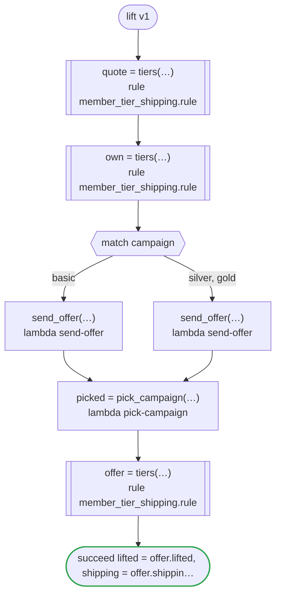

# lift v1

A campaign lifts a member's tier for one order, as far as the rule lets it: gold. The workflow holds what it is given to that range where it comes in (the campaign it is given, the campaign of the order, and the one a task picks), and hands each to the rule as it is. Runs on every platform

`tests/flows/lift.flow` を `dandori doc` で描いたものです。入力は `member: tiers.tier`・`campaign: tiers.tier range >=basic <=gold`・`order: Order`、出力は `lifted: bool`・`shipping: money[USD]`・`offered: tiers.tier range >=silver <=gold` です。

## flow

四角はタスク、両脇に線のある四角は規則、斜めの四角は外から値が届くタスク（イベントやコールバックの応答）、六角形は `match`、角の丸い四角は待ち、ステップを囲む枠はループです。破線の矢印は、呼び出しがその場で処理するエラーです。

## 呼び出し

| 行 | 呼び出し | 呼ぶもの | リトライ | タイムアウト | 失敗したとき |
|---:|---|---|---|---|---|
| 32 | `quote = tiers(…)` | 規則 `member_tier_shipping.rule` | 1 秒後と 2 秒後の 2 回（failure） | — | `timeout`・`failure` → ワークフローが失敗する |
| 34 | `own = tiers(…)` | 規則 `member_tier_shipping.rule` | 1 秒後と 2 秒後の 2 回（failure） | — | `timeout`・`failure` → ワークフローが失敗する |
| 37 | `send_offer(…)` | `lambda send-offer`・`key` | — | — | `timeout`・`failure` → ワークフローが失敗する |
| 38 | `send_offer(…)` | `lambda send-offer`・`key` | — | — | `timeout`・`failure` → ワークフローが失敗する |
| 40 | `picked = pick_campaign(…)` | `lambda pick-campaign`・`idempotent` | — | — | `timeout`・`failure` → ワークフローが失敗する |
| 41 | `offer = tiers(…)` | 規則 `member_tier_shipping.rule` | 1 秒後と 2 秒後の 2 回（failure） | — | `timeout`・`failure` → ワークフローが失敗する |

## 終わり方

ワークフローの終わり方のすべてです。

| 行 | 終わり方 |
|---:|---|
| 42 | `succeed lifted = offer.lifted, shipping = offer.shipping, offered = picked` |

## 規則

このワークフローが呼ぶ規則です。`rulec doc` が描いた、人が読むページをそのまま載せています。

<code>tiers</code> · member_tier_shipping v1 · <code>rules/member_tier_shipping.rule</code>

<!-- rulec 0.33.0 が member_tier_shipping.rule (sha256:01d90343a970) から生成した資料です。読むためのもので、もとになるのは .rule のほうです。ここを編集しても .rule には戻せません。 -->
# 規則 member_tier_shipping v1

Shipping by membership tier: gold and above ship free, and a campaign lifts a member to the campaign's tier for that order alone

## 入力

| 名前 | 型 | 範囲 | 注記 |
|---|---|---|---|
| member | tier（4 値） |  | the member's own tier |
| campaign | tier（4 値） | basic 〜 gold | a campaign lifts a member as far as gold |
| subtotal | money[USD] | 0USD 〜 10万USD |  |

## 出力

| 名前 | 型 | 丸め | 注記 |
|---|---|---|---|
| shipping | money[USD] | down(1USD) |  |
| effective | tier（4 値） |  |  |
| lifted | bool |  |  |

## 型

列挙は**閉じた**有限集合です。値を足すと、その値を扱っていない表は完全性の検査を通らなくなります。

- **tier**（4 値）— basic < silver < gold < platinum
  - 値はこの順に並びます。セルの `<gold` は「gold より前」、`>=gold` は「gold から後」です。

## 導出と定義

表の列に置ける中間の値です。式はもとの規則のとおりで、範囲は宣言されたものです。

| 名前 | 種類 | 式 | 範囲 | 注記 |
|---|---|---|---|---|
| effective | 定義 | `max(member, campaign)` |  |  |
| lifted | 定義 | `campaign > member` |  |  |

## 表 shipping_fee（policy unique）

| 列 | 出どころ |
|---|---|
| effective | 定義 |
| subtotal | 入力 |
| → shipping | この規則の出力 |

| # | effective | subtotal | → shipping（money[USD] / down(1USD)） |
|---|---|---|---|
| 1 | >=gold | - | 0USD |
| 2 | silver | >=50USD | 0USD |
| 3 | silver | <50USD | 5USD |
| 4 | basic | >=100USD | 0USD |
| 5 | basic | <100USD | 8USD |

**`rulec check` が確かめたこと**

- どの入力の組合せも、いずれかの行に当てはまります（E101 完全性）
- どの入力にも当てはまらない行はありません（E102）
- 二つ以上の行に同時に当てはまる入力はありません（E105 重なり）。行の並べ替えは意味を変えません

## 例（検証済み）

| member | campaign | subtotal | → shipping | effective | lifted |
|---|---|---|---|---|---|
| platinum | basic | 10USD | 0USD | platinum | false |
| basic | gold | 10USD | 0USD | gold | true |
| silver | basic | 60USD | 0USD | silver | false |
| silver | silver | 10USD | 5USD | silver | false |
| basic | basic | 99USD | 8USD | basic | false |

この 5 件は `rulec check` が参照評価器で実行し、すべて宣言どおりの値になりました（E107）。例は**実行される仕様**です。

