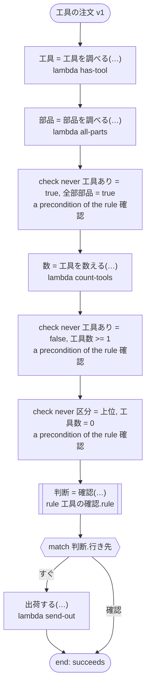

# 工具の注文 v1

注文の工具をすぐに出すか、先に確かめるかを決める。規則の `never` の行は、ここでは ritsu が決められない（注文の中身は範囲の無いタスクの結果から来て、真偽には範囲が無い）ので、ワークフローが値のできたところですぐに確かめる。

`tests/flows/never_lines.ja.flow`, drawn by `dandori doc`. Inputs: `注文: string`, `区分: 確認.区分`.

## flow



A rectangle is a task, one with a line down each side a rule, a slanted one a task whose value comes from outside (an event, or the answer to a callback), a hexagon a `match`, a rounded box a wait, and a box around steps a loop. A dashed arrow is an error the call handles.

## Calls

| Line | Call | Calls | Retries | Timeout | When it fails |
|---:|---|---|---|---|---|
| 29 | `工具 = 工具を調べる(…)` | `lambda has-tool`, `idempotent` | — | — | `timeout`, `failure` → the workflow fails |
| 30 | `部品 = 部品を調べる(…)` | `lambda all-parts`, `idempotent` | — | — | `timeout`, `failure` → the workflow fails |
| 32 | `数 = 工具を数える(…)` | `lambda count-tools`, `idempotent` | — | — | `timeout`, `failure` → the workflow fails |
| 33 | `判断 = 確認(…)` | rule `工具の確認.rule` | 2 times, after 1 second and 2 (failure, timeout) | 10 seconds | `timeout`, `failure` → the workflow fails |
| 35 | `出荷する(…)` | `lambda send-out`, `key` | — | — | `timeout`, `failure` → the workflow fails |

## Ends

Every way the workflow can end.

| Line | End |
|---:|---|
| 36 | the flow runs to its end, and the workflow succeeds |

## Rules

The rules this workflow calls, each as the page for people that `rulec doc` renders.

<details>
<summary><code>確認</code> · 工具の確認 v1 · <code>rules/工具の確認.rule</code></summary>

<!-- Generated by rulec 0.48.0 from 工具の確認.rule (sha256:441513aa9a29). This is a read-only rendering; the source of truth is the .rule file. Edits cannot be carried back. -->
# Rule 工具の確認 v1

注文の工具をすぐに出すか、先に確かめるかを決める。呼ぶ側は三つの組み合わせを起こさない。工具のある注文は部品だけではなく、工具のない注文は工具を数えず、上位の注文は工具が一つ以上ある。

## Inputs

| Name | Type | Range | Notes |
|---|---|---|---|
| 工具あり | bool |  |  |
| 全部部品 | bool |  |  |
| 工具数 | number | 0 to 5 |  |
| 区分 | 区分 (2 values) |  |  |

## Outputs

| Name | Type | Rounding | Notes |
|---|---|---|---|
| 行き先 | 経路 (2 values) |  |  |

## Types

An enum is a **closed** finite set. Add a value, and every table that does not look at it fails the completeness check.

- **経路** (2 values) — すぐ, 確認
- **区分** (2 values) — 通常, 上位

## These combinations do not happen

No table has a row for these combinations.

- `never 工具あり = true, 全部部品 = true`: the caller's promise. The generated code refuses a call that breaks it at its door.
- `never 工具あり = false, 工具数 >= 1`: the caller's promise. The generated code refuses a call that breaks it at its door.
- `never 区分 = 上位, 工具数 = 0`: the caller's promise. The generated code refuses a call that breaks it at its door.


## Table 振り分け (policy unique)

| Column | Source |
|---|---|
| 工具あり | Input |
| 区分 | Input |
| 工具数 | Input |
| → 行き先 | Output of this rule |

| # | 工具あり | 区分 | 工具数 | → 行き先 (経路) |
|---|---|---|---|---|
| 1 | true | 通常 | <=2 | すぐ |
| 2 | true | 通常 | >=3 | 確認 |
| 3 | true | 上位 | - | すぐ |
| 4 | false | - | - | すぐ |

**What `rulec check` verified**

- Every combination of inputs matches some row (E101 completeness)
- There is no row that can never match (E102 unreachable row)
- No input matches two or more rows at once (E105 overlap). Reordering the rows does not change the meaning

## Examples (verified)

| 工具あり | 全部部品 | 工具数 | 区分 | → 行き先 |
|---|---|---|---|---|
| true | false | 2 | 上位 | すぐ |
| true | false | 3 | 通常 | 確認 |
| false | true | 0 | 通常 | すぐ |

`rulec check` ran these 3 examples through the reference evaluator, and every one produced the declared values (E107). The examples are an **executable specification**.

</details>

## What check says

What `dandori check` says of this workflow, each with the run that gets there.

```text
warning[W104]: tests/flows/never_lines.ja.flow:33:1: nothing says what range `数` is in (the answer of `工具を数える` has no range), and `工具数` of the rule `確認` takes `>=0 <=5`
    33 |   let 判断 = 確認(工具あり: 工具, 全部部品: 部品, 工具数: 数, 区分: 区分)
```
