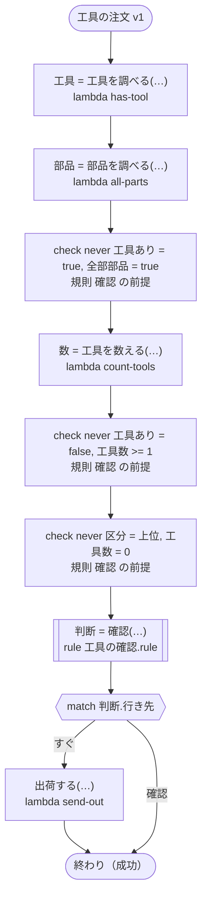

# 工具の注文 v1

注文の工具をすぐに出すか、先に確かめるかを決める。規則の `never` の行は、ここでは ritsu が決められない（注文の中身は範囲の無いタスクの結果から来て、真偽には範囲が無い）ので、ワークフローが値のできたところですぐに確かめる。

`tests/flows/never_lines.ja.flow` を `dandori doc` で描いたものです。入力は `注文: string`・`区分: 確認.区分` です。

## flow



四角はタスク、両脇に線のある四角は規則、斜めの四角は外から値が届くタスク（イベントやコールバックの応答）、六角形は `match`、角の丸い四角は待ち、ステップを囲む枠はループです。破線の矢印は、呼び出しがその場で処理するエラーです。

## 呼び出し

| 行 | 呼び出し | 呼ぶもの | リトライ | タイムアウト | 失敗したとき |
|---:|---|---|---|---|---|
| 29 | `工具 = 工具を調べる(…)` | `lambda has-tool`・`idempotent` | — | — | `timeout`・`failure` → ワークフローが失敗する |
| 30 | `部品 = 部品を調べる(…)` | `lambda all-parts`・`idempotent` | — | — | `timeout`・`failure` → ワークフローが失敗する |
| 32 | `数 = 工具を数える(…)` | `lambda count-tools`・`idempotent` | — | — | `timeout`・`failure` → ワークフローが失敗する |
| 33 | `判断 = 確認(…)` | 規則 `工具の確認.rule` | 1 秒後と 2 秒後の 2 回（failure・timeout） | 10 秒 | `timeout`・`failure` → ワークフローが失敗する |
| 35 | `出荷する(…)` | `lambda send-out`・`key` | — | — | `timeout`・`failure` → ワークフローが失敗する |

## 終わり方

ワークフローの終わり方のすべてです。

| 行 | 終わり方 |
|---:|---|
| 36 | flow が最後まで走り、ワークフローは成功する |

## 規則

このワークフローが呼ぶ規則です。`rulec doc` が描いた、人が読むページをそのまま載せています。

<details>
<summary><code>確認</code> · 工具の確認 v1 · <code>rules/工具の確認.rule</code></summary>

<!-- rulec 0.48.0 が 工具の確認.rule (sha256:441513aa9a29) から生成した資料です。読むためのもので、もとになるのは .rule のほうです。ここを編集しても .rule には戻せません。 -->
# 規則 工具の確認 v1

注文の工具をすぐに出すか、先に確かめるかを決める。呼ぶ側は三つの組み合わせを起こさない。工具のある注文は部品だけではなく、工具のない注文は工具を数えず、上位の注文は工具が一つ以上ある。

## 入力

| 名前 | 型 | 範囲 | 注記 |
|---|---|---|---|
| 工具あり | bool |  |  |
| 全部部品 | bool |  |  |
| 工具数 | number | 0 〜 5 |  |
| 区分 | 区分（2 値） |  |  |

## 出力

| 名前 | 型 | 丸め | 注記 |
|---|---|---|---|
| 行き先 | 経路（2 値） |  |  |

## 型

列挙は**閉じた**有限集合です。値を足すと、その値を扱っていない表は完全性の検査を通らなくなります。

- **経路**（2 値）— すぐ、確認
- **区分**（2 値）— 通常、上位

## この組み合わせは起こらない

どの表も、これらの組み合わせに行を持っていません。

- `never 工具あり = true, 全部部品 = true`：呼ぶ側の約束です。生成コードは、破る呼び出しを入口で受け付けません。
- `never 工具あり = false, 工具数 >= 1`：呼ぶ側の約束です。生成コードは、破る呼び出しを入口で受け付けません。
- `never 区分 = 上位, 工具数 = 0`：呼ぶ側の約束です。生成コードは、破る呼び出しを入口で受け付けません。


## 表 振り分け（policy unique）

| 列 | 出どころ |
|---|---|
| 工具あり | 入力 |
| 区分 | 入力 |
| 工具数 | 入力 |
| → 行き先 | この規則の出力 |

| # | 工具あり | 区分 | 工具数 | → 行き先（経路） |
|---|---|---|---|---|
| 1 | true | 通常 | <=2 | すぐ |
| 2 | true | 通常 | >=3 | 確認 |
| 3 | true | 上位 | - | すぐ |
| 4 | false | - | - | すぐ |

**`rulec check` が確かめたこと**

- どの入力の組合せも、いずれかの行に当てはまります（E101 完全性）
- どの入力にも当てはまらない行はありません（E102）
- 二つ以上の行に同時に当てはまる入力はありません（E105 重なり）。行の並べ替えは意味を変えません

## 例（検証済み）

| 工具あり | 全部部品 | 工具数 | 区分 | → 行き先 |
|---|---|---|---|---|
| true | false | 2 | 上位 | すぐ |
| true | false | 3 | 通常 | 確認 |
| false | true | 0 | 通常 | すぐ |

この 3 件は `rulec check` が参照評価器で実行し、すべて宣言どおりの値になりました（E107）。例は**実行される仕様**です。

</details>

## 検査の結果

`dandori check` の結果です。それぞれにそうなる例が付いています。

```text
警告[W104]: tests/flows/never_lines.ja.flow:33:1: `数` の範囲が分かりません（`工具を数える` の結果に範囲がありません）。規則 `確認` の `工具数` が受け取るのは `>=0 <=5` です
    33 |   let 判断 = 確認(工具あり: 工具, 全部部品: 部品, 工具数: 数, 区分: 区分)
```
