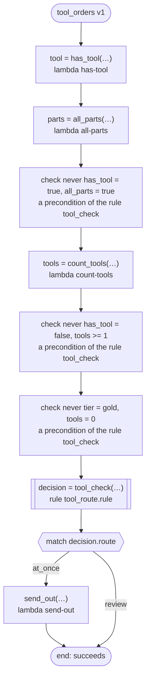

# tool_orders v1

Sends an order's tools out at once or holds them for a look first. ritsu cannot decide the rule's `never` lines here (what the order holds comes from tasks whose answers have no range, and a truth value has none), so the workflow checks each line as soon as its values are made.

`tests/flows/never_lines.flow`, drawn by `dandori doc`. Inputs: `order: string`, `tier: tool_check.tier`.

## flow



A rectangle is a task, one with a line down each side a rule, a slanted one a task whose value comes from outside (an event, or the answer to a callback), a hexagon a `match`, a rounded box a wait, and a box around steps a loop. A dashed arrow is an error the call handles.

## Calls

| Line | Call | Calls | Retries | Timeout | When it fails |
|---:|---|---|---|---|---|
| 29 | `tool = has_tool(…)` | `lambda has-tool`, `idempotent` | — | — | `timeout`, `failure` → the workflow fails |
| 30 | `parts = all_parts(…)` | `lambda all-parts`, `idempotent` | — | — | `timeout`, `failure` → the workflow fails |
| 32 | `tools = count_tools(…)` | `lambda count-tools`, `idempotent` | — | — | `timeout`, `failure` → the workflow fails |
| 33 | `decision = tool_check(…)` | rule `tool_route.rule` | 2 times, after 1 second and 2 (failure, timeout) | 10 seconds | `timeout`, `failure` → the workflow fails |
| 35 | `send_out(…)` | `lambda send-out`, `key` | — | — | `timeout`, `failure` → the workflow fails |

## Ends

Every way the workflow can end.

| Line | End |
|---:|---|
| 36 | the flow runs to its end, and the workflow succeeds |

## Rules

The rules this workflow calls, each as the page for people that `rulec doc` renders.

<details>
<summary><code>tool_check</code> · tool_route v1 · <code>rules/tool_route.rule</code></summary>

<!-- Generated by rulec 0.52.0 from tool_route.rule (sha256:d5b1a0fc38a9). This is a read-only rendering; the source of truth is the .rule file. Edits cannot be carried back. -->
# Rule tool_route v1

Whether an order's tools go out at once or are looked at first. The caller keeps three combinations from happening: an order with a tool does not hold only parts, an order with no tool counts none, and a gold order counts at least one.

## Inputs

| Name | Type | Range | Notes |
|---|---|---|---|
| has_tool | bool |  |  |
| all_parts | bool |  |  |
| tools | number | 0 to 5 |  |
| tier | tier (2 values) |  |  |

## Outputs

| Name | Type | Rounding | Notes |
|---|---|---|---|
| route | path (2 values) |  |  |

## Types

An enum is a **closed** finite set. Add a value, and every table that does not look at it fails the completeness check.

- **path** (2 values) — at_once, review
- **tier** (2 values) — basic, gold

## These combinations do not happen

No table has a row for these combinations.

- `never has_tool = true, all_parts = true`: the caller's promise. The generated code refuses a call that breaks it at its door.
- `never has_tool = false, tools >= 1`: the caller's promise. The generated code refuses a call that breaks it at its door.
- `never tier = gold, tools = 0`: the caller's promise. The generated code refuses a call that breaks it at its door.


## Table pick (policy unique)

| Column | Source |
|---|---|
| has_tool | Input |
| tier | Input |
| tools | Input |
| → route | Output of this rule |

| # | has_tool | tier | tools | → route (path) |
|---|---|---|---|---|
| 1 | true | basic | <=2 | at_once |
| 2 | true | basic | >=3 | review |
| 3 | true | gold | - | at_once |
| 4 | false | - | - | at_once |

**What `rulec check` verified**

- Every combination of inputs matches some row (E101 completeness)
- There is no row that can never match (E102 unreachable row)
- No input matches two or more rows at once (E105 overlap). Reordering the rows does not change the meaning

## Examples (verified)

| has_tool | all_parts | tools | tier | → route |
|---|---|---|---|---|
| true | false | 2 | gold | at_once |
| true | false | 3 | basic | review |
| false | true | 0 | basic | at_once |

`rulec check` ran these 3 examples through the reference evaluator, and every one produced the declared values (E107). The examples are an **executable specification**.

</details>

## What check says

What `dandori check` says of this workflow, each with the run that gets there.

```text
warning[W104]: tests/flows/never_lines.flow:33:1: nothing says what range `tools` is in (the answer of `count_tools` has no range), and `tools` of the rule `tool_check` takes `>=0 <=5`
    33 |   let decision = tool_check(has_tool: tool, all_parts: parts, tools: tools, tier: tier)
```
