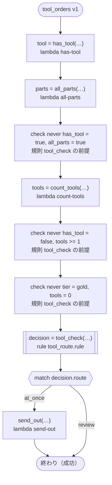

# tool_orders v1

Sends an order's tools out at once or holds them for a look first. ritsu cannot decide the rule's `never` lines here (what the order holds comes from tasks whose answers have no range, and a truth value has none), so the workflow checks each line as soon as its values are made.

`tests/flows/never_lines.flow` を `dandori doc` で描いたものです。入力は `order: string`・`tier: tool_check.tier` です。

## flow



四角はタスク、両脇に線のある四角は規則、斜めの四角は外から値が届くタスク（イベントやコールバックの応答）、六角形は `match`、角の丸い四角は待ち、ステップを囲む枠はループです。破線の矢印は、呼び出しがその場で処理するエラーです。

## 呼び出し

| 行 | 呼び出し | 呼ぶもの | リトライ | タイムアウト | 失敗したとき |
|---:|---|---|---|---|---|
| 29 | `tool = has_tool(…)` | `lambda has-tool`・`idempotent` | — | — | `timeout`・`failure` → ワークフローが失敗する |
| 30 | `parts = all_parts(…)` | `lambda all-parts`・`idempotent` | — | — | `timeout`・`failure` → ワークフローが失敗する |
| 32 | `tools = count_tools(…)` | `lambda count-tools`・`idempotent` | — | — | `timeout`・`failure` → ワークフローが失敗する |
| 33 | `decision = tool_check(…)` | 規則 `tool_route.rule` | 1 秒後と 2 秒後の 2 回（failure・timeout） | 10 秒 | `timeout`・`failure` → ワークフローが失敗する |
| 35 | `send_out(…)` | `lambda send-out`・`key` | — | — | `timeout`・`failure` → ワークフローが失敗する |

## 終わり方

ワークフローの終わり方のすべてです。

| 行 | 終わり方 |
|---:|---|
| 36 | flow が最後まで走り、ワークフローは成功する |

## 規則

このワークフローが呼ぶ規則です。`rulec doc` が描いた、人が読むページをそのまま載せています。

<details>
<summary><code>tool_check</code> · tool_route v1 · <code>rules/tool_route.rule</code></summary>

<!-- rulec 0.55.0 が tool_route.rule (sha256:d5b1a0fc38a9) から生成した資料です。読むためのもので、もとになるのは .rule のほうです。ここを編集しても .rule には戻せません。 -->
# 規則 tool_route v1

Whether an order's tools go out at once or are looked at first. The caller keeps three combinations from happening: an order with a tool does not hold only parts, an order with no tool counts none, and a gold order counts at least one.

## 入力

| 名前 | 型 | 範囲 | 注記 |
|---|---|---|---|
| has_tool | bool |  |  |
| all_parts | bool |  |  |
| tools | number | 0 〜 5 |  |
| tier | tier（2 値） |  |  |

## 出力

| 名前 | 型 | 丸め | 注記 |
|---|---|---|---|
| route | path（2 値） |  |  |

## 型

列挙は**閉じた**有限集合です。値を足すと、その値を扱っていない表は完全性の検査を通らなくなります。

- **path**（2 値）— at_once、review
- **tier**（2 値）— basic、gold

## この組み合わせは起こらない

どの表も、これらの組み合わせに行を持っていません。

- `never has_tool = true, all_parts = true`：呼ぶ側の約束です。生成コードは、破る呼び出しを入口で受け付けません。
- `never has_tool = false, tools >= 1`：呼ぶ側の約束です。生成コードは、破る呼び出しを入口で受け付けません。
- `never tier = gold, tools = 0`：呼ぶ側の約束です。生成コードは、破る呼び出しを入口で受け付けません。


## 表 pick（policy unique）

| 列 | 出どころ |
|---|---|
| has_tool | 入力 |
| tier | 入力 |
| tools | 入力 |
| → route | この規則の出力 |

| # | has_tool | tier | tools | → route（path） |
|---|---|---|---|---|
| 1 | true（はい） | basic | <=2（2以下） | at_once |
| 2 | true（はい） | basic | >=3（3以上） | review |
| 3 | true（はい） | gold | - | at_once |
| 4 | false（いいえ） | - | - | at_once |

`-` は、その列がどの値でもよいことを表します。

**`rulec check` が確かめたこと**

- どの入力の組合せも、いずれかの行に当てはまります（E101 完全性）
- どの入力にも当てはまらない行はありません（E102）
- 二つ以上の行に同時に当てはまる入力はありません（E105 重なり）。行の並べ替えは意味を変えません

## 例（検証済み）

| has_tool | all_parts | tools | tier | → route |
|---|---|---|---|---|
| true | false | 2 | gold | at_once |
| true | false | 3 | basic | review |
| false | true | 0 | basic | at_once |

この 3 件は `rulec check` が参照評価器で実行し、すべて宣言どおりの値になりました（E107）。例は**実行される仕様**です。

</details>

## 検査の結果

`dandori check` の結果です。それぞれにそうなる例が付いています。

```text
警告[W104]: tests/flows/never_lines.flow:33:1: `tools` の範囲が分かりません（`count_tools` の結果に範囲がありません）。規則 `tool_check` の `tools` が受け取るのは `>=0 <=5` です
    33 |   let decision = tool_check(has_tool: tool, all_parts: parts, tools: tools, tier: tier)
```
