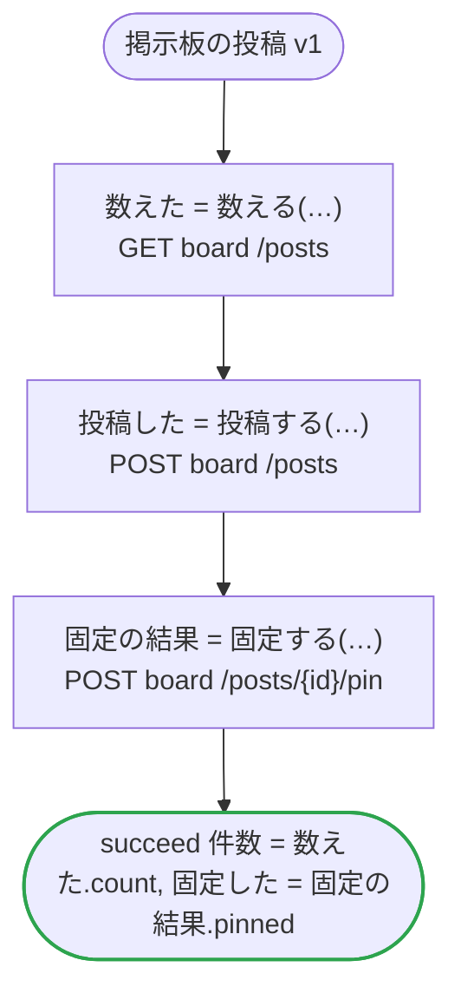

# 掲示板の投稿 v1

ある日までの話題の投稿を数え、メモを付けて投稿し、それを固定する。日とメモは無いことがある

`tests/flows/none_values.ja.flow`, drawn by `dandori doc`. Inputs: `話題: string`, `いつまで: date?`, `メモ: string?`. Outputs: `件数: int range >=0 <=1000`, `固定した: bool`.

## flow

A rectangle is a task, one with a line down each side a rule, a slanted one a task whose value comes from outside (an event, or the answer to a callback), a hexagon a `match`, a rounded box a wait, and a box around steps a loop. A dashed arrow is an error the call handles.

## Calls

| Line | Call | Calls | Retries | Timeout | When it fails |
|---:|---|---|---|---|---|
| 45 | `数えた = 数える(…)` | `GET board /posts`, `idempotent` | — | — | `timeout`, `failure` → the workflow fails |
| 46 | `投稿した = 投稿する(…)` | `POST board /posts` | — | — | `timeout`, `failure` → the workflow fails |
| 47 | `固定の結果 = 固定する(…)` | `POST board /posts/{id}/pin` | — | — | `timeout`, `failure` → the workflow fails |

## Ends

Every way the workflow can end.

| Line | End |
|---:|---|
| 48 | `succeed 件数 = 数えた.count, 固定した = 固定の結果.pinned` |

