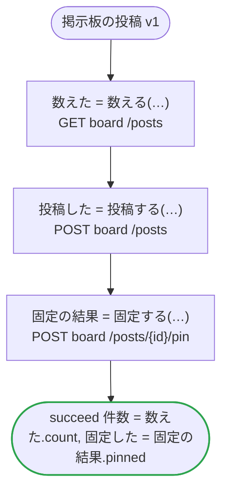

# 掲示板の投稿 v1

ある日までの話題の投稿を数え、メモを付けて投稿し、それを固定する。日とメモは無いことがある

`tests/flows/none_values.ja.flow` を `dandori doc` で描いたものです。入力は `話題: string`・`いつまで: date?`・`メモ: string?`、出力は `件数: int range >=0 <=1000`・`固定した: bool` です。

## flow

四角はタスク、両脇に線のある四角は規則、斜めの四角は外から値が届くタスク（イベントやコールバックの応答）、六角形は `match`、角の丸い四角は待ち、ステップを囲む枠はループです。破線の矢印は、呼び出しがその場で処理するエラーです。

## 呼び出し

| 行 | 呼び出し | 呼ぶもの | リトライ | タイムアウト | 失敗したとき |
|---:|---|---|---|---|---|
| 45 | `数えた = 数える(…)` | `GET board /posts`・`idempotent` | — | — | `timeout`・`failure` → ワークフローが失敗する |
| 46 | `投稿した = 投稿する(…)` | `POST board /posts` | — | — | `timeout`・`failure` → ワークフローが失敗する |
| 47 | `固定の結果 = 固定する(…)` | `POST board /posts/{id}/pin` | — | — | `timeout`・`failure` → ワークフローが失敗する |

## 終わり方

ワークフローの終わり方のすべてです。

| 行 | 終わり方 |
|---:|---|
| 48 | `succeed 件数 = 数えた.count, 固定した = 固定の結果.pinned` |

