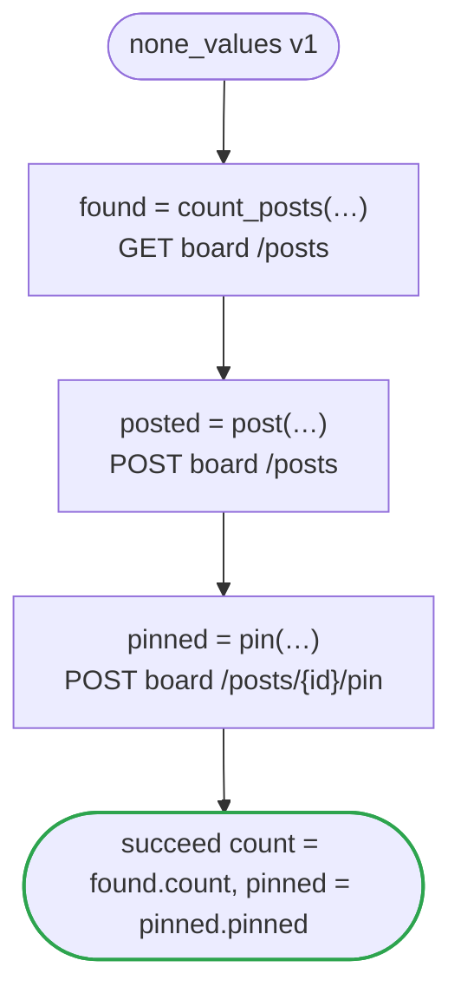

# none_values v1

Count a topic's posts up to a day, post a note on it and pin the post, where the day and the note may not be there

`tests/flows/none_values.flow`, drawn by `dandori doc`. Inputs: `topic: string`, `until: date?`, `note: string?`. Outputs: `count: int range >=0 <=1000`, `pinned: bool`.

## flow

A rectangle is a task, one with a line down each side a rule, a slanted one a task whose value comes from outside (an event, or the answer to a callback), a hexagon a `match`, a rounded box a wait, and a box around steps a loop. A dashed arrow is an error the call handles.

## Calls

| Line | Call | Calls | Retries | Timeout | When it fails |
|---:|---|---|---|---|---|
| 46 | `found = count_posts(…)` | `GET board /posts`, `idempotent` | — | — | `timeout`, `failure` → the workflow fails |
| 47 | `posted = post(…)` | `POST board /posts` | — | — | `timeout`, `failure` → the workflow fails |
| 48 | `pinned = pin(…)` | `POST board /posts/{id}/pin` | — | — | `timeout`, `failure` → the workflow fails |

## Ends

Every way the workflow can end.

| Line | End |
|---:|---|
| 49 | `succeed count = found.count, pinned = pinned.pinned` |

